<!-- page: Couverture -->
# Retail Intelligence Platform

## Dossier d’architecture technique

Jour 1 · UC-01 et UC-02

**Analyse du besoin, qualification de TPCx-BB et conception d’une plateforme décisionnelle**

IPSSI · Mastère Développement, Data & Intelligence Artificielle · 5e année

16 novembre 2026 · Version 1.2

**Kevin GREGOIRE**

<!-- page: Synthèse -->
# Résumé exécutif

Retail Intelligence souhaite mieux suivre ses ventes en magasin et sur le web, comprendre les retours et comparer les niveaux de stock. Ce dossier s’appuie sur les 36 fichiers distribués, soit un peu plus d’un gigaoctet. Il relie les décisions aux mesures disponibles et propose une architecture pour les publier.

| Ce que montrent les fichiers | Conséquence pour le pilotage |
| --- | --- |
| 89 100 tickets magasin et 89 100 commandes web dans l’initial | Calculer par canal et identifiant. Conserver chaque ligne, même quand un article se répète dans une transaction. |
| 57,16 % du net payé initial vient du web, sur 1 808 dates communes | Comparer les canaux sur les mêmes dates et faire confirmer la base monétaire avant diffusion. |
| Le résultat des ventes se réconcilie avec le coût d’achat fourni. La perte de retour diverge de la formule TPC. | Présenter la mesure de ventes comme un résultat du kit. Garder la perte de retour en contrôle de source. |
| 19 retours magasin sur 426 et 29 retours web sur 400 trouvent une vente candidate dans le refresh | Publier les quantités et montants à la date du retour. Le taux par cohorte reste suspendu. |
| 232 380 références produit du stock initial sont résolues par le refresh | Compléter le référentiel avant de publier des résultats par produit. |

## Architecture retenue

Le choix est un **Data Lake en trois zones**, alimenté par lots. Bronze conserve les fichiers reçus. Silver contrôle le schéma, les clés et les dates. Gold expose les ventes, les retours et les snapshots au bon grain, puis calcule les ratios à partir de leurs composantes. Parquet sert au stockage analytique. Linux et Azure sont présentés comme cibles d’architecture.

Finance valide les conventions de montant, la devise et la clôture avant diffusion. L’équipe Data contrôle la couverture, les relations et la version publiée. Les chiffres P09 décrivent le jeu synthétique et servent à éprouver ces règles.

<!-- page: Sommaire -->
# Sommaire

| Pages | Contenu | Éléments du TP1 |
| --- | --- | --- |
| 4 | Cadrage métier et décisions attendues | 01 |
| 5–7 | Utilisateurs, questions décisionnelles et schéma fonctionnel | 02 |
| 8–13 | Ventes, finance, retours, stocks, clients, web et prix de marché | 03 |
| 14–18 | Méthode, provenance, inventaires et lecture physique | 04 |
| 19–22 | Profil qualité, clés, relations et rafraîchissement | 05 |
| 23 | Limites et validations attendues | 06 |
| 24 | Comparaison Data Warehouse, Data Lake et Lakehouse | 07 |
| 25 | Architecture logique cible | 08 |
| 26–27 | Flux, contrôles et zones de données | 09 |
| 28–29 | Déclinaison locale et composants | 10 |
| 30–32 | Modèle dimensionnel et publication Gold | 05, 08, 09 |
| 33–34 | Gouvernance, sécurité et exploitation | 11 |
| 35–36 | Transposition Azure et comparaison local / cloud | 12 |
| 37 | Couverture des 12 éléments et index des preuves | 01–12 |
| 38 | Conclusion et sources | 01–12 |
| 39–44 | [Annexe A · Preuves techniques P01 à P06](#p39) | 03–06 |

## Lire les résultats

Les statuts du TP distinguent les observations directes (**vérifié**), les conclusions appuyées par l’analyse (**déduit**), les propositions à tester (**hypothèse**) et les informations absentes (**non disponible**). Un point **à valider** demande une décision ou une confirmation.

Les pages 8 à 13 présentent les principaux calculs. Le classeur KPI contient le détail des champs, des jointures, des filtres et des valeurs par lot. Les six captures PowerShell sont réunies dans l’[annexe A](#p39). La page 37 indique aussi les fichiers de résultats associés à chaque preuve.

<!-- page: UC-01 · Cadrage -->
# 01 · Cadrage métier

Retail Intelligence est une enseigne fictive qui vend en magasin et sur le web. Les ventes, les retours et les inventaires proviennent de plusieurs systèmes. La direction commerciale veut comparer l’activité des canaux. Finance doit pouvoir expliquer les écarts de montant et les rapprocher des champs disponibles. [D1 §2, D2 ch. 1–2]

| Profil | Responsabilité | Décisions à rendre possibles |
| --- | --- | --- |
| Direction générale | Piloter la performance consolidée | Réviser les objectifs, répartir l’effort entre canaux. |
| Direction commerciale | Suivre ventes, familles et conditions tarifaires | Adapter l’assortiment et examiner écarts de prix. |
| Contrôle de gestion | Fiabiliser les agrégats et leurs règles | Réconcilier net payé, coupons, remises, taxes et résultat du kit. |
| Responsable de magasin | Suivre le périmètre de son établissement | Adapter l’espace de vente et diagnostiquer les motifs de retour. |
| Logistique / stocks | Analyser les niveaux d’inventaire | Repérer les positions à zéro et examiner les délais d’expédition. |
| Équipe Data | Intégrer, documenter et contrôler les sources | Bloquer une publication ou isoler les lignes hors contrat. |

## Périmètre et résultat attendu

Le Jour 1 couvre l’analyse du besoin, l’examen des lots présents et la conception d’une chaîne décisionnelle. Les données éclairent les ventes, les retours, le stock, les clients, la navigation et les prix. Une restitution doit donner, avec chaque chiffre, son canal, sa période, la version du lot et sa couverture.

Le système cible relève de l’**OLAP**. Il regroupe des événements historiques pour permettre agrégation, filtrage et détail contrôlé. Les fichiers pédagogiques tiennent lieu d’entrées. La gestion opérationnelle d’un ticket, la modification de l’inventaire et la passation de commande appartiennent au périmètre transactionnel **OLTP**. [D3 diap. 9–18]

## Contraintes et critères d’acceptation

- Les définitions Finance et Commerce doivent utiliser le même périmètre de montant et de temps. Une période incomplète est signalée à la restitution.
- Les décisions magasin s’appuient sur le canal physique et un périmètre d’accès limité au magasin. Les décisions logistiques distinguent snapshot d’entrepôt et stock en rayon.
- Les preuves doivent pouvoir être rejouées à partir du dossier source, en lecture seule. Les choix d’infrastructure découlent du TP1 et de la progression du fil rouge.

<!-- page: UC-01 · Questions -->
# 02 · Questions décisionnelles

| Profil · ID | Priorité | Question / données | KPI · décision | Faisabilité |
| --- | --- | --- | --- | --- |
| Direction générale · Q01 | Indispensable | Quel canal contribue le plus au montant des ventes ? Ventes + calendrier. | K01, K27 · Arbitrer les moyens par canal | Calculable sur périmètre commun |
| Direction générale · Q02 | Indispensable | L’activité progresse-t-elle sur des mois complets comparables ? Ventes + dates. | K05 · Réviser les objectifs | Calculable sous contrôle de couverture |
| Direction commerciale · Q03 | Indispensable | Quels produits se vendent le plus par canal ? Ventes + item. | K02 · Adapter l’assortiment | Calculable avec item initial + refresh |
| Direction commerciale · Q04 | Utile | Quelle réduction est observée face au prix catalogue ? Montants étendus et net payé. | K08, K18, K19, K20 · Examiner la politique tarifaire | Écart descriptif, causalité indisponible |
| Contrôle de gestion · Q05 | Indispensable | Comment se répartissent net payé, taxes et résultat des ventes du kit ? Ventes, coût et calendrier. | K01, K13, K14, K17 · Réconcilier les agrégats | Calculable en unité du kit |
| Contrôle de gestion · Q06 | Utile | Combien de transactions et quel panier par canal ? Tickets / commandes + net payé. | K03, K04, K21 · Distinguer trafic d’achat et valeur | Calculable par canal et sur paniers complets |
| Responsable magasin · Q07 | Indispensable | Quelles familles contribuent au volume de mon magasin ? Ventes magasin + store + item. | K02 · Réallouer l’espace et les assortiments | Calculable sur ventes magasin |

## Lecture de la priorité

Les priorités donnent l’ordre des usages. La faisabilité dépend des champs et du grain disponibles. Un besoin prioritaire peut donc rester en attente d’une source ou d’une validation.

<!-- page: UC-01 · Questions -->
# Questions opérationnelles et qualité

| Profil · ID | Priorité | Question / données | KPI · décision | Faisabilité |
| --- | --- | --- | --- | --- |
| Responsable magasin · Q08 | Utile | Quels produits ou motifs concentrent les volumes et montants de retour ? Retours, motifs et produits. | K06, K15, K16 · Examiner produits et motifs | Volumes et montants HT mesurés. Perte à qualifier. |
| Logistique · Q09 | Indispensable | Quels niveaux de stock par entrepôt au dernier snapshot ? Inventory + date_dim + warehouse + item. | K07, K22 · Prioriser les contrôles de disponibilité | Calculable avec couverture |
| Logistique · Q10 | Utile | Quels entrepôts ont des niveaux nuls observés ? Inventory et maillage attendu. | K22 · Vérifier ruptures et qualité | Zéros observés, rupture magasin indisponible |
| Équipe Data · Q11 | Indispensable | Quelle part des clics possède un client identifié ? Web_clickstreams + customer. | K11, K24 · Qualifier la segmentation | Calculable, couverture seulement |
| Équipe Data · Q12 | Complémentaire | Quelles familles d’articles recueillent les avis les mieux notés ? Product_reviews + item. | K10, K23 · Prioriser l’exploration des avis | Calculable, biais de sélection |
| Direction commerciale · Q13 | Utile | Combien de clients identifiés ont acheté par canal ? Ventes + customer. | K09 · Comparer la couverture de clientèle | Calculable selon rôle client |
| Contrôle de gestion · Q14 | Utile | Quelle part des quantités vendues revient à terme ? Retour rattaché + cohorte vente close. | K12 · Cibler les causes des retours | Suspendu, rattachement et maturité insuffisants |
| Logistique · Q15 | Utile | Quel délai s’écoule entre vente web et expédition ? Dates vente et expédition web, calendrier. | K25 · Examiner les délais par entrepôt | Calculable à la ligne, délai livraison absent |
| Direction commerciale · Q16 | Complémentaire | Le prix courant se situe-t-il au-dessus des offres concurrentes comparables ? Produit et prix de marché, fenêtres de validité. | K26 · Qualifier un comparatif de prix | Diagnostic exploratoire, comparabilité à valider |

## Décisions qui demandent une source en plus

Le responsable magasin peut suivre les quantités et les motifs des retours. Finance a besoin d’un lien vers la vente d’origine pour suivre le taux d’une cohorte. La logistique dispose de snapshots d’entrepôt. Pour décider sur les ruptures en rayon, il faudrait des mouvements ou des observations de stock en magasin.

<!-- page: UC-01 · Schéma fonctionnel -->
# Du besoin métier aux sources

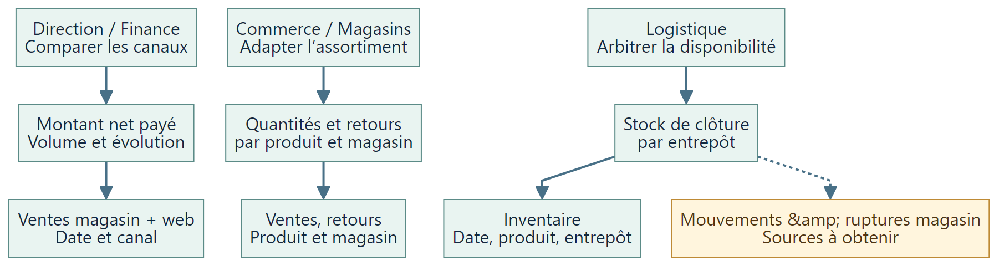

**Légende.** Les liens pleins mènent aux domaines observés. Le lien pointillé mène à une donnée métier attendue dont la source reste à obtenir.

| Domaine | Fichiers observés | Arbitrage rendu possible |
| --- | --- | --- |
| Ventes et calendrier | store_sales.dat, web_sales.dat, date_dim.dat | Mesurer valeur, volume et évolution à dates et canaux comparables. |
| Produits, magasins et retours | item.dat, store.dat, store_returns.dat, web_returns.dat, reason.dat | Analyser les lignes vendues ou retournées et les motifs. |
| Stocks entrepôt | inventory.dat, warehouse.dat, item.dat, date_dim.dat | Comparer des niveaux de stock à la même date de snapshot. |
| Navigation et avis | web_clickstreams.dat, product_reviews.dat | Quantifier la couverture des clics et décrire les avis, en restant au grain de la source. |
| Stocks magasin et mouvements | Source supplémentaire non disponible | Chercher une source opérationnelle avec lieu, horodatage, type et quantité. |

Dans une restitution Gold, l’utilisateur accède au filtre du canal avant le niveau de détail. Le responsable magasin descend du magasin vers la famille ou le produit. Finance remonte des lignes vers le jour puis le mois, à périmètre constant. Les accès par profil sont détaillés page 33.

<!-- page: UC-01 · KPI -->
# 03 · Ventes et activité commerciale

Le tableau compare les canaux sur le lot initial. Les montants sont exprimés en unités monétaires du kit (UM). Les deux canaux ont **1 808 dates de vente communes**. Les valeurs du rafraîchissement restent identifiables dans P09 et le classeur KPI.

| Indicateur | Règle de calcul | Magasin | Web |
| --- | --- | --- | --- |
| K01 · Net payé HT | Somme de ss_net_paid ou ws_net_paid, avant retours. Taxes et port web suivis à part. | 1 150 529 586,37 | 1 535 374 825,67 |
| K02 · Unités vendues | Somme de ss_quantity ou ws_quantity, au grain de la ligne. | 33 755 474 | 33 724 378 |
| K03 · Transactions | En-têtes distincts par canal. Un ticket magasin et une commande web sont deux transactions. | 89 100 | 89 100 |
| K04 · Panier moyen HT | Net payé des transactions complètes / nombre de ces transactions, après agrégation des lignes. | 12 912,79 UM | 17 232,04 UM |
| K21 · Unités par transaction | Quantité des transactions complètes / nombre de ces transactions. | 378,85 | 378,50 |
| K27 · Part du net payé | Net payé du canal / somme des deux canaux sur les dates communes, en %. Base monétaire à confirmer. | 42,84 % | 57,16 % |
| K05 · Variation mensuelle | 100 × (novembre − octobre) / octobre 2005. Même définition du net payé sur deux mois entièrement observés. | -0,26 % | -3,86 % |

## Le panier se calcule à partir des en-têtes

Les **89 100 valeurs d’identifiant** de l’initial sont communes aux deux canaux. Il faut conserver le canal dans la clé analytique. Les couples transaction–produit se répètent, avec des lignes de vente distinctes. Toutes les transactions ont passé le contrôle de complétude retenu pour ces calculs. Une segmentation par article peut sélectionner des paniers, puis le montant du panier reprend toutes leurs lignes. Les comptes distincts par site ne s’additionnent pas. [P04 · clés candidates](#p42) · P09.

**Usage.** Un écart de valeur entre les canaux peut venir du volume, de la composition des paniers ou du prix payé par unité. La lecture croisée de K03, K04 et K21 permet de distinguer ces effets. Pour K05, le calendrier confirme la présence de tous les jours d’octobre et de novembre. La clôture métier reste à confirmer avant diffusion.

<!-- page: UC-01 · KPI -->
# Finance, prix et remises

| Indicateur | Règle de calcul | Magasin | Web |
| --- | --- | --- | --- |
| K13 · Résultat des ventes du kit | Somme de ss_net_profit ou ws_net_profit. Les valeurs signées sont conservées. | -552 553 374,82 | -168 576 494,45 |
| K14 · Taux de résultat du kit | 100 × somme du résultat K13 / somme du net payé HT sur les mêmes lignes. | -48,03 % | -10,98 % |
| K17 · Taxes sur les ventes | Somme de ss_ext_tax ou ws_ext_tax, hors taxes des retours. | 51 688 496,63 | 69 021 450,95 |
| K18 · Coupons enregistrés | Somme de ss_coupon_amt ou ws_coupon_amt, zéros inclus. | 126 694 418,24 | 168 867 948,81 |
| K19 · Remises de prix | Somme de ss_ext_discount_amt ou ws_ext_discount_amt, déjà étendues aux quantités. | 1 276 714 271,73 | 1 706 138 195,14 |
| K20 · Prix net par unité | Somme du net payé HT / somme des unités vendues sur les mêmes lignes. | 34,08 UM | 45,53 UM |
| K08 · Écart net au catalogue | 100 × somme(catalogue étendu − net payé HT) / somme du catalogue étendu, sur les mêmes lignes. | 54,95 % | 54,98 % |

## Ce que les champs financiers mesurent

Pour les deux lots et les deux canaux, les contrôles ont trouvé **zéro écart** pour les identités suivantes. La remise enregistrée égale le catalogue étendu moins le montant de vente étendu. Le net payé égale le montant de vente étendu moins le coupon. Le TTC égale le net payé plus la taxe. Le résultat du kit égale le net payé moins le coût d’achat étendu. Ces identités sont vérifiées sur les lignes, en centimes. [P09]

K08 rapporte un écart global au catalogue. K18 et K19 isolent deux composantes en UM. Il faut éviter de les compter une deuxième fois dans l’écart global. Les résultats négatifs du kit sont à conserver. K13 et K14 éclairent l’écart au coût fourni, avec un périmètre limité aux ventes synthétiques. Les charges d’exploitation et autres coûts de l’enseigne restent hors du jeu. [D4, P09]

<!-- page: UC-01 · KPI -->
# Retours, montants et rattachement

| Indicateur | Règle de calcul | Magasin | Web |
| --- | --- | --- | --- |
| K06 · Unités retournées | Somme de sr_return_quantity ou wr_return_quantity par date de retour. | 972 092 | 992 087 |
| K15 · Montant HT des retours | Somme de sr_return_amt ou wr_return_amt. Rapprochement HT + taxe = TTC. | 36 688 696,43 | 50 260 175,31 |
| K16 · Perte enregistrée | Somme de sr_net_loss ou wr_net_loss, à titre descriptif. Interprétation de la formule à valider. | 40 071 461,72 | 54 391 267,43 |
| K12 · Taux d’unités retournées | Unités de retour attribuées / unités vendues de la même cohorte, après maturité, en %. | Suspendu | Suspendu |

## Les montants de retour se lisent à la date de l’événement

Les volumes et les montants HT se calculent sur les lignes de retour, sans jointure aux ventes. Le HT et la taxe donnent le TTC sur chaque ligne. Le champ de perte est complet et non négatif. Dans l’initial, la formule du TPC diffère de la valeur livrée sur **37 899 des 37 902 lignes magasin** et **38 485 des 38 487 lignes web**. La divergence touche aussi les 826 lignes du refresh. Dans les quatre fichiers, la valeur suit exactement « port retour + deux fois la taxe ». K16 sert au contrôle de la source jusqu’à validation de sa définition. [D4, P09]

## Pourquoi le taux par cohorte reste suspendu

Parmi les retours rafraîchis, **19 sur 426** en magasin et **29 sur 400** sur le web ont au moins une vente candidate. Deux de ces 29 retours web ont plusieurs correspondances. Le calcul requiert une clé d’origine fiable, une règle pour les retours successifs et une fenêtre de maturité commune à la cohorte. Une division des retours datés du mois par les ventes du mois mélangerait deux populations. [P06 · rapprochement des retours](#p44).

<!-- page: UC-01 · KPI -->
# Stocks et départ des expéditions web

**K07 · Quantité de stock observée.** Somme des quantités connues et non négatives à une date, sur des triplets uniques date–produit–entrepôt. **K22 · Part des positions à zéro.** Nombre de triplets à zéro / nombre de triplets avec quantité connue et non négative, en %. Ces deux mesures sont calculables avec leurs effectifs de couverture. [P04 · grain du stock](#p42) · [P05 · référentiels](#p43) · P09.

| Snapshot du 12/12/2005 | Triplets observés | Quantités connues | Zéros | K07 · unités | K22 |
| --- | --- | --- | --- | --- | --- |
| data | 35 100 | 35 091 | 47 | 17 446 138 | 0,134 % |
| data_refresh | 54 900 | 54 884 | 53 | 27 510 720 | 0,097 % |
| Réunion simulée | 90 000 | 89 975 | 100 | 44 956 858 | 0,111 % |

Les deux fichiers couvrent des triplets disjoints à cette date. La réunion atteint **90 000 triplets**, correspondant à 18 000 produits × 5 entrepôts dans le panier de référence, avec **25 quantités inconnues**. Cette réunion illustre la couverture. La règle de chargement du refresh reste à confirmer. Le nombre de triplets attendus et le nombre de quantités connues répondent à deux questions différentes. Les positions à zéro décrivent l’inventaire d’entrepôt à une date. [P09]

## K25 · Délai avant expédition

Deux jointures vers le calendrier résolvent `ws_sold_date_sk` et `ws_ship_date_sk`. La mesure divise la somme des écarts de jours non négatifs par le nombre de lignes web comparables. Le lot initial donne **60,50 jours calendaires** sur **668 052 lignes**. Les délais vont de 1 à 120 jours. Aucune date d’expédition n’est vide, hors référentiel ou antérieure à la vente. Le rafraîchissement donne **60,29 jours** sur 6 879 lignes.

**82 676 commandes** de l’initial comportent plusieurs dates d’expédition. Le délai moyen reste au grain de la ligne. Un délai par commande requiert un choix entre première expédition, dernière expédition et expédition complète. La date de livraison est indisponible dans les fichiers. [P09]

<!-- page: UC-01 · KPI -->
# Clients, navigation et avis

| Indicateur | Règle et population | Lot initial | Rafraîchissement |
| --- | --- | --- | --- |
| K09 · Clients acheteurs identifiés | Clients distincts de la vente magasin et clients facturés distincts du web, par canal. | 37 336 magasin · 37 367 web | 827 magasin · 847 web |
| K24 · Événements de navigation | Nombre de lignes web_clickstreams de largeur conforme. Les événements sans client restent inclus. | 6 770 550 | 68 988 |
| K11 · Clics avec client résolu | Lignes dont le client est résolu / toutes les lignes de clic valides, en %. | 57,85 % | 57,72 % |
| K23 · Nombre d’avis | Avis distincts par pr_review_sk. La clé est unique dans chacun des lots. | 89 991 | 909 |
| K10 · Note moyenne | Somme des notes valides sur le nombre d’avis notés. Les notes observées vont de 1 à 5. | 4,24 / 5 | 4,20 / 5 |

**Clients.** Le client de vente et le client facturé occupent des rôles définis dans les sources. Toute comparaison multicanale de clients exige un périmètre commun et un calcul distinct sur ce périmètre. Les montants de ventes doivent conserver les lignes qui n’ont pas de client attribué.

**Web.** Pour K11, **3 917 089 des 6 770 550** lignes initiales portent une clé client résolue. Les clics anonymes restent dans le volume. Les 164 lignes initiales et les 2 lignes du refresh sans identifiant de page figurent dans une catégorie « page inconnue » si la restitution ventile le total. Compter les lignes observées ne permet pas de reconstituer des visiteurs, des sessions ou des conversions. [P05, P09]

**Avis.** Afficher la note moyenne avec l’effectif d’avis notés et le total K23. Tous les avis de ces deux lots ont une note valide. Un filtre date ou produit change l’effectif. Les auteurs d’avis forment une population sélectionnée. [P04, P09]

<!-- page: UC-01 · KPI -->
# Prix concurrents et contrôles de publication

## K26 · Un écart observable sous hypothèses

Le comparatif s’appuie sur `i_current_price`, l’identité du produit et les offres `imp_competitor_price` avec dates de début et de fin. Le 12 décembre 2005, la convention « fin exclue » donne **4 458 offres actives** dans le lot initial. La convention « fin incluse » en donne **4 672**. Il manque **29 prix concurrents** et l’intervalle de validité ne se résout pas pour **30 lignes** du lot initial. [P09]

Pour éviter les jointures multiplicatives, le diagnostic retient une observation par couple produit–concurrent, puis calcule la médiane des offres actives par produit. Sur **3 924 produits comparables selon ces règles**, le prix courant du catalogue dépasse la médiane concurrente de **0,58 UM par produit** en moyenne pondérée à parts égales entre produits. Le résultat décrit la convention d’essai. La devise, la taxe, l’unité produit et la validité de l’offre doivent être alignées avant publication. Le refresh ne contient aucune offre active à la date de cet essai. [P09]

## Conditions qui changent une décision

| Niveau de lecture | Indicateurs concernés | Contrôle avant diffusion |
| --- | --- | --- |
| Calcul observé | K01, K02, K03, K06, K09–K11, K13, K15, K17–K19, K23–K24 | Contrôler types et couverture puis garder le lot et la période visibles. |
| Calcul sous conditions | K04, K05, K07, K08, K14, K16, K20–K22, K25, K27 | Vérifier le dénominateur, le grain, la période ou le sens du champ selon l’indicateur. K16 reste descriptif tant que la formule n’est pas validée. |
| Diagnostic à valider | K26 | Fixer convention d’intervalle, unité, base de prix et source marché. |
| Suspendu | K12 | Obtenir une attribution à la ligne et fermer la fenêtre de retour. |

Les preuves **P09** donnent les montants et effectifs par lot, les contrôles de cohérence et les champs audités. Le classeur KPI détaille les colonnes, filtres, jointures et limites des douze définitions d’origine et des nouveaux indicateurs. Les ratios y gardent leur numérateur et leur dénominateur.

<!-- page: UC-01 · Inventaire -->
# 04 · Source et protocole de lecture

| Information | État au Jour 1 |
| --- | --- |
| Documents pédagogiques locaux | TP1.pdf, projet_fil_rouge.pdf et Cours 1 .pdf. Inventoriés et empreintés. |
| Kit constaté | retail_project/retail_project avec data et data_refresh. Archive ZIP absente du périmètre. |
| Provenance | Dossier pédagogique local. Mode de distribution et date de mise à disposition non communiqués. |
| Génération | Version du générateur, paramètres, échelle et adaptations du kit non vérifiés. |
| Référence de schéma | TPCx-BB v1.7.0, juin 2025, consultée auprès du TPC. Annexe B p. 62–92 et annexe G p. 120–137. |
| Autres fichiers | Les deux rapports d’audit de prix sont livrés avec le kit. Aucune autre source complémentaire recensée. |

## Établir la correspondance des colonnes

L’annexe B.1 décrit les colonnes utilisées par les requêtes et leurs rôles. L’annexe B.2 aide à interpréter leur génération. L’ordre de lecture vient des déclarations Hive temporaires `ROW FORMAT … STORED AS TEXTFILE` de l’annexe G. Le script extrait les 23 listes ordonnées et enregistre la page source de chaque table. Les positions critiques concordent avec la largeur lue, les types et la couverture des jointures. La correspondance est **déduite et corroborée** pour ce jeu. Le DDL ou le manifeste exact de la distribution locale reste à valider. D4 · [P02 · colonnes de ventes magasin](#p40).

## Étendue des contrôles

- **Exhaustif** sur chaque fichier pour octets, empreinte SHA-256, lignes physiques, encodage observable, fins de ligne, largeur et champs vides. Les `.dat` sont lus ligne par ligne sans recopier les données.
- **Exhaustif** sur les clés candidates, les relations sélectionnées, les dates des événements et les mesures prioritaires. Les relations sont évaluées sur l’initial seul puis sur tous les référentiels livrés.
- **Échantillon de tête** de 20 000 lignes par fichier au maximum pour les types lexicaux de toutes les colonnes et les répétitions de ligne dans cet échantillon. Trois aperçus par fichier sont masqués. Les doublons exacts des ventes et des retours font l’objet d’un contrôle exhaustif distinct. [P01–P06]

<!-- page: UC-01 · Inventaire -->
# Lot initial · Dimensions et référentiels

| Fichier | Domaine | Lignes | Octets | Champs | Homologue |
| --- | --- | --- | --- | --- | --- |
| customer.dat | Clients | 99 000 | 13 279 063 | 18 | Oui |
| customer_address.dat | Adresses | 49 500 | 5 387 229 | 13 | Oui |
| customer_demographics.dat | Démographie clients | 1 920 800 | 77 753 083 | 9 | — |
| date_dim.dat | Calendrier | 109 573 | 15 395 800 | 28 | — |
| household_demographics.dat | Démographie foyers | 7 200 | 155 100 | 5 | — |
| income_band.dat | Tranches de revenu | 20 | 327 | 3 | — |
| item.dat | Produits | 17 820 | 6 799 286 | 22 | Oui |
| promotion.dat | Promotions | 300 | 46 396 | 19 | — |
| reason.dat | Motifs de retour | 35 | 3 105 | 3 | — |
| ship_mode.dat | Modes d’expédition | 20 | 1 220 | 6 | — |
| store.dat | Magasins | 12 | 3 386 | 29 | — |
| time_dim.dat | Heure de la journée | 86 400 | 5 107 780 | 10 | — |
| warehouse.dat | Entrepôts | 5 | 584 | 14 | — |
| web_page.dat | Pages web | 60 | 8 040 | 14 | — |
| web_site.dat | Sites web | 30 | 8 838 | 26 | — |

**Chemin relatif.** Chaque fichier est sous `data/<table>/<fichier>`. La colonne « Homologue » indique un fichier de même nom et domaine dans le lot rafraîchi. Les volumes sont exprimés en octets bruts. Chaque `.dat` de cette page est un texte délimité par `|`, sans en-tête, en CRLF. `customer.dat` contient de l’UTF-8 non ASCII. Les autres fichiers de cette page sont entièrement ASCII, compatible UTF-8. [P01 · inventaire des lots](#p39).

**Clés des dimensions.** Les clés candidates sont les identifiants de substitution déclarés dans le DDL de lecture. Leurs unicités ont été vérifiées sur les 15 tables de cette page. L’égalité entre clé métier et grain d’une dimension est à requalifier si une prochaine livraison historise plusieurs versions du même objet. [P04]

<!-- page: UC-01 · Inventaire -->
# Lot initial · Faits, événements et audit

| Fichier | Domaine | Lignes | Octets | Champs | Homologue |
| --- | --- | --- | --- | --- | --- |
| inventory.dat | Stocks | 23 255 100 | 424 943 678 | 4 | Oui |
| item_marketprices.dat | Prix concurrents | 89 100 | 4 201 170 | 6 | Oui |
| item_marketprices_audit.csv | Audit de génération | 5 | 273 | 0, 1, 8 | Oui |
| product_reviews.dat | Avis | 89 991 | 56 355 389 | 8 | Oui |
| store_returns.dat | Retours magasin | 37 902 | 4 337 400 | 20 | Oui |
| store_sales.dat | Ventes magasin | 667 579 | 92 764 700 | 23 | Oui |
| web_clickstreams.dat | Navigation | 6 770 550 | 178 722 140 | 6 | Oui |
| web_returns.dat | Retours web | 38 487 | 5 383 513 | 24 | Oui |
| web_sales.dat | Ventes web | 668 052 | 133 790 574 | 34 | Oui |

| Périmètre | Fichiers | Octets | Lignes physiques |
| --- | --- | --- | --- |
| Lot data · tous les fichiers | 24 | 1 024 448 074 | 33 907 541 |
| Dont tables .dat | 23 | 1 024 447 801 | 33 907 536 |
| Dont audit composite | 1 | 273 | 5 |

## Variété et formats observés

Les `.dat` sont tabulaires, en ASCII et CRLF, avec séparateur `|`, sans en-tête. Les avis contiennent du texte libre dans un champ d’une table à huit positions. Les clics sont des événements à six positions. Le kit examiné ne comporte aucun fichier JSON ni donnée binaire. Le CSV de prix est un rapport composite à virgules, avec un en-tête et un résumé à huit champs, des libellés de section et une ligne blanche. [P01–P03]

**Contrôle croisé.** Le lot initial contient **89 100** lignes de prix, alors que le champ d’audit `numCompetitors` vaut **89 099**. Le bilan du rafraîchissement affiche **900** pour **900** lignes. La sémantique du compteur et l’écart initial restent à valider. Le rapport CSV n’est pas utilisé pour produire des prix unitaires ou reconstituer les mesures. [P01]

<!-- page: UC-01 · Inventaire -->
# Lot rafraîchi · Contenu et périmètre

| Fichier | Domaine | Lignes | Octets | Champs | Homologue |
| --- | --- | --- | --- | --- | --- |
| customer.dat | Clients | 1 000 | 134 360 | 18 | Oui |
| customer_address.dat | Adresses | 500 | 54 587 | 13 | Oui |
| inventory.dat | Stocks | 234 900 | 4 292 915 | 4 | Oui |
| item.dat | Produits | 180 | 69 173 | 22 | Oui |
| item_marketprices.dat | Prix concurrents | 900 | 42 547 | 6 | Oui |
| item_marketprices_audit.csv | Audit de génération | 17 986 | 151 009 | 0, 1, 2, 8 | Oui |
| product_reviews.dat | Avis | 909 | 573 685 | 8 | Oui |
| store_returns.dat | Retours magasin | 426 | 48 825 | 20 | Oui |
| store_sales.dat | Ventes magasin | 6 632 | 922 171 | 23 | Oui |
| web_clickstreams.dat | Navigation | 68 988 | 1 821 864 | 6 | Oui |
| web_returns.dat | Retours web | 400 | 55 952 | 24 | Oui |
| web_sales.dat | Ventes web | 6 879 | 1 378 425 | 34 | Oui |

| Périmètre | Fichiers | Octets | Lignes physiques |
| --- | --- | --- | --- |
| Lot data_refresh · tous les fichiers | 12 | 9 545 513 | 339 700 |
| Dont tables .dat | 11 | 9 394 504 | 321 714 |
| Dont audit composite | 1 | 151 009 | 17 986 |

Les `.dat` ont tous la même largeur que leur homologue initial. Ils sont sans en-tête, délimités par `|`, en CRLF. `customer.dat` contient de l’UTF-8 non ASCII, les autres sont entièrement ASCII. Le fichier d’audit contient aussi 17 981 lignes à deux champs. Ces sections et le résumé restent traçables dans Bronze. La simple présence d’un homologue ne fixe ni une opération d’append ni une date d’effet. [P01, P06]

<!-- page: UC-01 · Qualification des formats -->
# Colonnes et types structurants

| Table | Positions utiles dans le .dat, base 1 | Types de référence |
| --- | --- | --- |
| store_sales | 1 date · 3 produit · 4 client · 8 magasin · 10 ticket · 11 quantité · 21 net payé | Clés bigint, quantité int, montant decimal(7,2) |
| web_sales | 1 date · 4 produit · 5 client facturé · 14 site · 16 entrepôt · 18 commande · 19 quantité · 30 net payé | Clés bigint, quantité int, montant decimal(7,2) |
| store_returns | 1 date retour · 3 produit · 8 magasin · 9 motif · 10 ticket · 11 quantité | Clés bigint et quantité int |
| web_returns | 1 date retour · 3 produit · 4 client remboursé · 13 motif · 14 commande · 15 quantité | Clés bigint et quantité int |
| inventory | 1 date · 2 produit · 3 entrepôt · 4 quantité disponible | Trois bigint, un int |
| item / date_dim | item 1 i_item_sk, 2 i_item_id · date_dim 1 d_date_sk, 3 d_date | Clé bigint ; code et date physique texte |
| web_clickstreams | 1 date · 2 heure · 3 vente candidate · 4 produit · 5 page · 6 client | Six bigint selon le DDL, plusieurs champs facultatifs |
| product_reviews | 1 identifiant · 2 date · 3 heure · 4 note · 5 produit · 6 auteur · 7 commande candidate · 8 contenu | Clés bigint, note int, date/heure et contenu texte |
| item_marketprices | 1 identifiant · 2 produit · 3 concurrent · 4 prix · 5 début · 6 fin | Clés bigint, concurrent texte et prix decimal(7,2) |

## Contrats de lecture

Le dictionnaire joint donne les noms DDL exacts, rangs, types, pages, valeurs vides et nombre de lignes contrôlées. Les fichiers bruts s’interprètent d’abord comme du texte. Une date portée en texte ne devient une date qu’après validation. Une clé de substitution 0 est une valeur présente dans le jeu et doit être évaluée contre le référentiel.

**Le pipe terminal est significatif.** Sur `time_dim`, 50 400 lignes se terminent par un pipe parce que le dixième champ `t_meal_time` est vide. L’enlever déplacerait le contrôle de largeur de 10 à 9. La règle s’applique aussi aux stocks et aux clics. Aucun champ d’entête n’est absorbé par le parseur. [P02 · colonnes](#p40) · [P03 · largeur et champs vides](#p41).

<!-- page: UC-01 · Qualité -->
# 05 · Profil de qualité

| Contrôle | Mesure / périmètre | Interprétation |
| --- | --- | --- |
| Structure et encodage | 34 .dat, largeur attendue sur toutes les lignes ; aucune erreur UTF-8 | Parseur pipe strict utilisable. Les deux audits nécessitent un traitement différent. |
| Types lexicaux | 0 incompatibilité sur les premières lignes conformes, jusqu’à 20 000 par fichier .dat | Échantillon sans erreur observée. Typage complet à réexécuter lors de l’ingestion. |
| Valeurs vides du stock | 5 999 initial + 63 refresh sur la quantité ; zéros distincts 23 125 + 237 | La valeur vide reste inconnue. Les deux comptes doivent figurer dans Gold. |
| Clics sans lien de vente | 6 102 498 / 6 770 550 initial ; 62 109 / 68 988 refresh | Champ wcs_sales_sk vide environ 90 % du temps. Nature de la clé et fenêtre à confirmer. |
| Clics sans client | 2 853 461 / 6 770 550 initial ; 29 167 / 68 988 refresh | Une part des événements reste sans client identifiable. Préserver ce périmètre dans les couvertures. |
| Historisation produit | i_rec_end_date vide pour 18 000 lignes sur les deux lots | Fin de validité ouverte possible. Aucune chronologie multi-version démontrée pour un même i_item_id. |
| Notes d’avis / prix | Notes 1–5 sur 90 900 avis. 29 prix vides initial ; 0 prix négatif mesuré | Statistique de note possible avec l’effectif. Exclure et signaler les prix manquants. |

## Contrôles chiffrés sur les ventes

| Canal · data | Lignes | Unités | Net payé HT | Taxes étendues |
| --- | --- | --- | --- | --- |
| Magasin | 667 579 | 33 755 474 | 1 150 529 586,37 | 51 688 496,63 |
| Web | 668 052 | 33 724 378 | 1 535 374 825,67 | 69 021 450,95 |

Les sommes sont des contrôles de réconciliation en unité monétaire du kit. Elles portent sur le lot initial et sur toutes les lignes lues, avec addition décimale. Les profits nets négatifs sont nombreux (495 971 lignes magasin, 407 163 web) et conservés pour examen. Les contrôles P09 retrouvent le résultat du kit en retranchant le coût d’achat étendu du montant net, y compris pour les lignes négatives. Les quantités vendues sont strictement positives sur les deux lots. [P06]

<!-- page: UC-01 · Clés et relations -->
# Clés, cardinalités et intégrité

| Référence | Lignes avec référence · initial | Absentes initial | Absentes tous référentiels | Grain / décision |
| --- | --- | --- | --- | --- |
| store_sales → date / produit / magasin / client | 667 579 par relation | 0 | 0 | N lignes vers une dimension ; jour, produit, établissement, client |
| web_sales → date / produit / client facturé | 668 052 par relation | 0 | 0 | N:1 au grain ligne, rôles facture et expédition séparés |
| inventory → item | 23 255 100 | 232 380 | 0 | Dimension item complète requise pour Gold |
| inventory → date / entrepôt | 23 255 100 par relation | 0 | 0 | Grain stock unique date × produit × entrepôt |
| web_sales refresh → produit / client facturé | 6 879 par relation | 66 / 127 | 0 / 0 | Intégrer les dimensions refresh avant les faits |
| web_sales refresh → adresse de facturation | 6 869 / 6 879 | 138 sur renseignées | 0 | 10 absentes à traiter sans perdre les faits |
| web_clickstreams → customer | 3 917 089 / 6 770 550 | 0 | 0 | N:0..1, reclassement « non renseigné » côté analytique |

## Méthode et décisions de jointure

Les comparaisons utilisent les positions DDL, des références numériques de même famille et les clés cibles dont l’unicité a été testée. Le rapprochement est une anti-jointure sur références renseignées, avec compteur séparé des vides et des valeurs invalides. La couverture après enrichissement avec `data_refresh` ne prouve pas que la dimension était disponible lors d’une livraison initiale autonome.

Le rafraîchissement apporte exactement **180** produits, **1 000** clients et **500** adresses, sans chevauchement par clé technique ni par identifiant métier dans les deux lots constatés. Le chemin initial et rafraîchi reste visible dans le catalogue. Pour les clics et avis, la ressemblance entre une référence de vente et un numéro d’en-tête ne suffit pas à publier une relation à un achat. P04 (`03_cles.csv`) · [P05 · intégrité référentielle](#p43).

<!-- page: UC-01 · Rapprochements -->
# Transactions et retours

| Contrôle | Magasin initial | Web initial | Magasin refresh | Web refresh |
| --- | --- | --- | --- | --- |
| Lignes de vente | 667 579 | 668 052 | 6 632 | 6 879 |
| En-têtes distincts | 89 100 | 89 100 | 900 | 900 |
| Lignes au-delà du grain candidat transaction × produit | 4 136 | 4 076 | 46 | 39 |
| Lignes strictement identiques au-delà de la première | 0 | 0 | 0 | 0 |
| Retours avec au moins une vente au couple testé | 37 902 / 37 902 | 38 487 / 38 487 | 19 / 426 | 29 / 400 |
| Dont retours à plusieurs ventes candidates | 470 | 439 | 0 | 2 |
| Retours sans vente trouvée sur lots comparables | 0 | 0 | 407 | 371 |

## Ticket, commande et panier

Les 89 100 valeurs d’identifiant d’en-tête de l’initial sont communes aux deux canaux. Par canal, les identifiants sont complets, numériques, associés à une seule date de vente renseignée et à un seul client renseigné par rôle testé. Au magasin, ils sont associés à un seul établissement. En web, **82 468** commandes initiales portent plusieurs sites renseignés. Un total de commandes par site serait non additif. [P04, P06]

Le couple ticket ou commande × produit échoue à l’unicité. La colonne `repetitions` compte les lignes en excès après la première occurrence de chaque clé. Le contrôle distinct des lignes complètes donne zéro doublon exact dans les quatre fichiers de ventes. Le nombre de transactions se calcule par identifiant d’en-tête et canal. Les agrégats de ventes gardent les lignes qui satisfont les contrôles de qualité. [P04 · détail des répétitions](#p42) · `07_diagnostics.csv`.

## Contrat pour un taux de retour

Le couple produit × identifiant permet de chercher des ventes candidates, avec **zéro, une ou plusieurs** correspondances. Pour les retours initialement rattachés à une seule ligne, le contrôle n’observe ni retour antérieur à la vente ni quantité de la ligne de retour supérieure à la quantité de la vente. Les clients diffèrent sur 3 748 liens magasin et 5 182 web parmi les comparables. En web, client facturé et client remboursé sont des rôles distincts. Sans identifiant de ligne d’origine et règle de cohorte, l’attribution et le taux restent suspendus. [P06]

<!-- page: UC-01 · Cohérence des lots -->
# Rafraîchissement et fenêtres métier

| Événement | Couverture data | Couverture data_refresh | Conséquence |
| --- | --- | --- | --- |
| Vente magasin et web | 01/01/2001–13/12/2005 | 13/12/2005–31/12/2005 | Frontière commune le 13/12. Aucun en-tête ni clé transaction × article de vente en commun par canal. |
| Clics et début du prix marché | 01/01/2001–13/12/2005 | 13/12/2005–31/12/2005 | Fenêtres comparables. Clic sans identifiant d’événement stable vérifié. |
| Stock entrepôt | 01/01/2001–12/12/2005 · 259 dates | 12/12/2005–26/12/2005 · 3 dates | Une date en commun, zéro triplet commun. Vérifier le maillage avant de comparer deux snapshots. |
| Retours magasin | 25/01/2001–14/11/2007 | 24/08/2001–02/06/2007 | Le lot refresh apporte aussi des événements sur la période initiale. |
| Retours web | 26/01/2001–18/03/2008 | 15/04/2001–15/12/2007 | Deux lignes refresh par canal de retour portent une clé candidate déjà vue dans l’initial. |
| Avis | 01/01/2001–01/01/2006 | 05/01/2001–01/01/2006 | Fenêtres chevauchantes, clés d’avis disjointes. |

## Politique de chargement proposée

Conserver le chemin d’origine, l’empreinte, le lot et la date d’événement comme attributs distincts. Charger les référentiels requis avant publication des faits. Le passage du 13 décembre et les retours rétroactifs interdisent un filtre global qui ne garderait que les dates postérieures au maximum initial. Le rapprochement des retours utilise les deux lots de ventes pour les événements rafraîchis, puis conserve les non-appariés avec un motif explicite.

Rejouer un fichier identique sans créer de lignes supplémentaires au moyen du registre d’ingestion. Une nouvelle empreinte pour le même chemin appelle une décision de version. Une collision sur une clé candidate de retour n’établit ni correction ni suppression. Une règle d’intégration métier doit être confirmée avant l’agrégation des deux lots de retours. [P04, P06]

<!-- page: UC-01 · Hypothèses -->
# 06 · Limites et validations attendues

| ID · statut | Constat ou question ouverte | Action / impact si non résolu |
| --- | --- | --- |
| H01 · Non disponible | Version du générateur, facteur d’échelle, commande et date de distribution absents du kit local | Demander la provenance au formateur ; référencer le dossier reçu et ses empreintes. |
| H02 · Déduit | Ordre du DDL officiel corroboré par les largeurs, types et jointures | Obtenir le DDL ou le manifeste exact du générateur pour lever l’incertitude de provenance. |
| H03 · À valider | Opérations attendues par table lors du refresh et périmètres de snapshot | Demander le protocole de lot. Maintenir les versions séparées lorsque le sens de la fusion est inconnu. |
| H04 · Non disponible | Devise et règle de clôture comptable absentes du périmètre | Finance valide la convention. Indiquer unité du kit et afficher la couverture de période. |
| H05 · Vérifié | Clés transaction × produit non uniques ; retours partiellement rattachables | Conserver les lignes. Suspendre le taux cohorte jusqu’à obtention de la clé d’origine et de la politique de retours. |
| H06 · Non disponible | Identifiant de session fiable et flux de mouvements stock magasin absents des sources examinées | Demander ces événements si le projet doit mesurer conversion ou rupture magasin. |
| H07 · Hypothèse | Champ de fin de version vide interprétable comme intervalle ouvert | Traiter comme nul en Silver. Tester l’historisation seulement avec des intervalles documentés. |
| H08 · À valider | Écart d’une unité entre audit de prix et nombre de lignes initiales | Confirmer la définition de numCompetitors avant d’utiliser l’audit pour valider un lot. |
| H09 · Vérifié | Données de référence du scénario synthétiques | Utiliser les agrégats comme exercices analytiques et preuves de traitement. |
| H10 · À valider | Règle d’attribution unique d’une commande web à un site | Restituer le nombre de commandes au niveau canal et date, puis définir le besoin par site. |
| H13 · À valider | Le champ net_loss des retours diverge de la règle TPC. | Conserver la valeur source et faire confirmer sa définition avant de l’utiliser comme coût. |
| H14 · À valider | Le comparatif de prix est sensible à la borne de validité et à la base de prix. | Aligner les conventions d’offre, la taxe, l’unité et la devise. |
| H15 · Non disponible | La date de livraison n’est pas fournie. Plusieurs dates d’expédition existent par commande. | Suivre le délai à la ligne. Définir une règle avant de produire un délai par commande. |

**Dépendances.** H02 et H03 conditionnent la politique de publication du lot rafraîchi. H04 borne l’interprétation financière. H05 et H06 ferment les usages pour lesquels le grain ou la couverture font défaut. P09 documente aussi l’écart de définition des pertes et les conditions de comparaison des prix et délais. Le registre précise qui peut lever ces incertitudes.

<!-- page: UC-02 · Comparaison -->
# 07 · Choix d’architecture analytique

| Critère | Data Warehouse | Data Lake | Data Lakehouse |
| --- | --- | --- | --- |
| Structure / formats | Schéma intégré, données typées, tables SQL | Formats natifs en brut, Parquet en zones préparées | Fichiers ouverts et métadonnées de tables |
| Variété / souplesse | Transformations avant intégration, souplesse via zones dédiées | Conserve événements et textes, rejouable | Conserve la diversité et stabilise les tables exposées |
| Traitements / requêtes | SQL OLAP, optimiseur, agrégats | ELT Python/Spark, performance selon lecture et partitions | Moteurs analytiques à choisir pour le format de table |
| Transactions | Transactions gérées par le moteur | Publication contrôlée à concevoir, pas d’ACID multi-fichiers via Parquet | Transactions et instantanés selon la couche choisie |
| Évolutivité / coûts | Coût du calcul, de l’intégration et de la capacité | Stockage extensible, scans et exploitation à maîtriser | Coût du calcul, catalogue, métadonnées, compaction |
| Qualité / gouvernance | Contraintes et gouvernance du modèle intégré | Contrats de schéma et contrôles à implémenter | Schémas et historique de table selon moteur, politiques toujours nécessaires |
| Sécurité | Accès centralisés aux tables et vues | Contrôles sur fichiers, chemins et moteurs | Contrôles sur fichiers et catalogue, à harmoniser |
| Pertinence Retail | Très bon pour les marts ; brut et rejeu demandent un espace séparé | Retenu pour lots de forme variée, historisation et Gold en étoile | Évolution si le refresh exige des mutations concurrentes ou du time travel |

## Décision et critères de réexamen

Le Data Lake en zones est retenu pour conserver et rejouer les deux lots, préserver le texte d’avis et isoler les rapports à sections. Il permet de charger d’abord le brut puis de transformer, selon le principe **ELT**. Les marts Gold en étoile fournissent un point d’accès SQL qui sert les besoins de BI structurée du scénario.

La taille mesurée, proche de 1,03 Go, ne motive pas à elle seule un cluster. HDFS et Spark répondent à la progression du parcours et à la possibilité de travailler sur des volumes plus élevés. Le Lakehouse devient pertinent si une fréquence de mutations, une concurrence d’écriture ou un historique transactionnel est établi. Le choix d’une couche de tables s’évalue alors avec les moteurs de lecture et les coûts d’exploitation. [D1 §5.2 ; D3 diap. 39–50]

<!-- page: UC-02 · Architecture logique -->
# 08 · Architecture logique cible

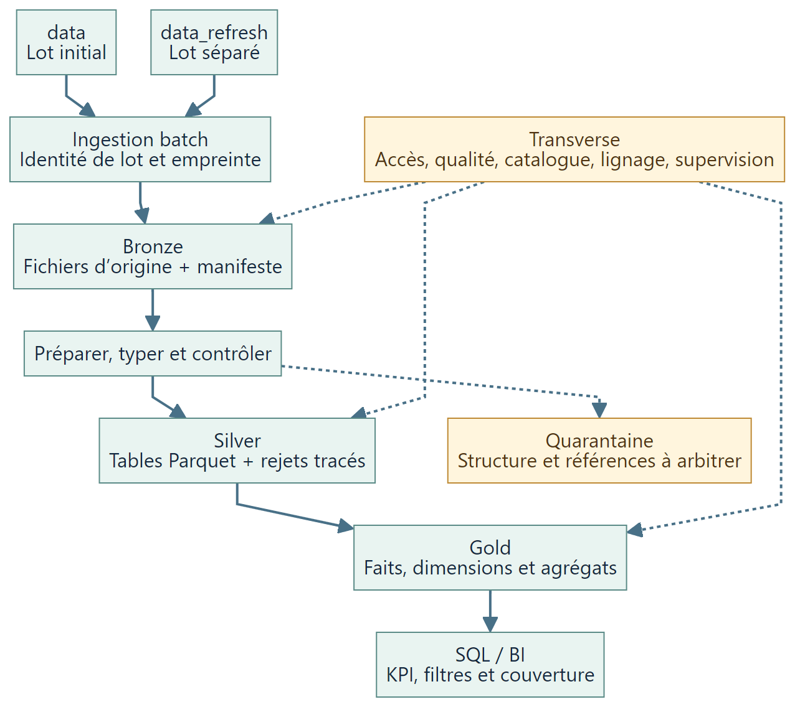

**Légende.** Les liens pleins suivent le flux principal. Les pointillés signalent les contrôles transverses ou la sortie d’erreur. Le schéma décrit la cible des prochaines étapes du parcours.

Bronze conserve les octets et un manifeste. Silver expose des tables typées, les indicateurs de couverture et les anomalies de rapprochement. Gold fige un ensemble cohérent de versions pour les utilisateurs métier. L’exposition lit uniquement cette publication et son contexte temporel. L’architecture isole les reprises d’ingestion du calendrier des ventes et retours.

Le registre de publication lie chaque mart à ses versions Silver, ses artefacts de transformation et sa définition de KPI. L’ordre de traitement tient compte du stock initial qui référence des articles du refresh. Tant que la dimension n’est pas complète, le statut Gold du périmètre concerné reste en attente.

<!-- page: UC-02 · Flux et zones -->
# 09 · Flux, contrôles et usages

| Flux batch | Entrée / volume brut initial | Préparation et contrôle | Produit et consommateur |
| --- | --- | --- | --- |
| Référentiels | 15 .dat initiaux ; 3 homologues | Vérifier la largeur et les clés, joindre les nouvelles références, traiter dates et fins vides | Silver connu par lot ; dimensions Gold pour les métiers |
| Ventes | store_sales.dat · 92 764 700 o ; web_sales.dat · 133 790 574 o | Contrôler date, montant et quantité ; préserver grain source ; composer la clé d’en-tête canal + ID | Gold par jour et canal, composantes de finance, en-têtes et délais d’expédition web ; Commerce et Finance |
| Retours | store_returns.dat · 4 337 400 o ; web_returns.dat · 5 383 513 o | Isoler comparables, multiples et orphelins du lien vente ; agréger par date de retour | Gold volumes, montants HT et motifs ; responsables magasin et commerce |
| Stocks | inventory.dat · 424 943 678 o | Intégrité produit/date/entrepôt ; mesurer couverture du snapshot ; comparer zéro et vide | Gold stock, zéros et couverture par snapshot ; Logistique |
| Interactions | web_clickstreams.dat · 178 722 140 o ; product_reviews.dat · 56 355 389 o | Résoudre produit et page/client le cas échéant ; contrôler note et couverture ; restreindre texte d’avis | Silver spécialisé, effectifs d’avis et d’événements en Gold ; équipe Data |
| Marché et audits | item_marketprices.dat · 4 201 170 o ; audit initial · 273 o | Typage prix/périodes, comparaison au rapport composite, rapprochement par produit et validité | Silver prix, audit isolé ; Commerce et Data |

## Organisation des chemins cibles

- `/bronze/tpcxbb/<lot>/<table>/<sha256>/<fichier>` conserve les octets et un pointeur vers le manifeste.
- `/silver/tpcxbb/<table>/batch_id=<id>/` contient les fichiers Parquet typés et leur version de contrat. Le registre de lot identifie les subdivisions si utilisées.
- `/gold/<jeu>/publication_id=<id>/` contient des versions immuables de marts. Un manifeste autorisé énumère les jeux publiés ensemble.
- `/quarantine/tpcxbb/<lot>/<table>/` conserve motifs et pointeurs avec accès restreint. Le registre distingue les erreurs bloquantes des données optionnelles.

Un flux continu suppose un besoin de latence et une source d’événements opérationnelle. Les fichiers disponibles et le calendrier du TP motivent un flux batch. [P01, P05–P06]

<!-- page: UC-02 · Reprise et publication -->
# Bronze, Silver et Gold

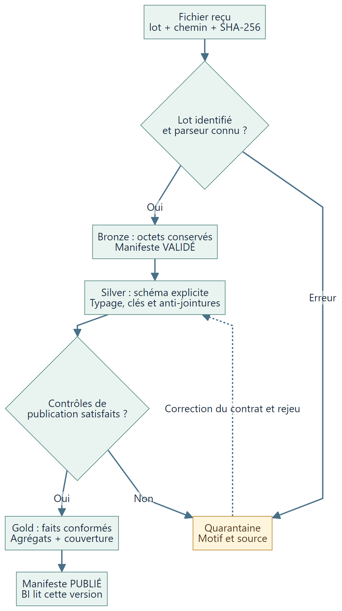

**Légende.** Les losanges indiquent les conditions d’entrée et de publication. L’orange signale la quarantaine. Le trait pointillé représente le rejeu après résolution, à partir de Bronze pour tout fichier déjà reçu.

**Bronze.** Un fichier lisible est enregistré avec empreinte et identifiant de lot. Un format inconnu peut être conservé dans un espace brut isolé avec un statut bloqué. La validation du manifeste atteste la réception et l’intégrité du fichier.

**Silver et Gold.** Une erreur de clé critique empêche la promotion du périmètre concerné. Les fichiers de sortie sont d’abord écrits dans une version de travail. Le manifeste est commis après les contrôles et sert de point de lecture. Une reprise peut remettre en service la dernière version publiée.

<!-- page: UC-02 · Local -->
# Architecture technique locale

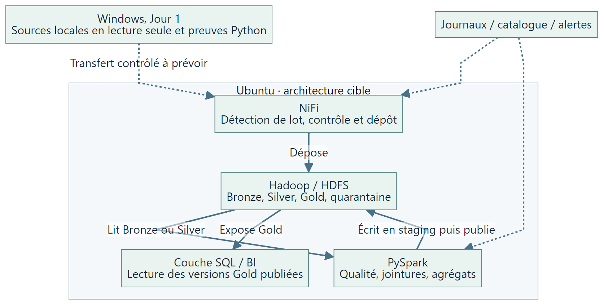

**Légende.** Le bloc Ubuntu est proposé pour la suite du parcours. La flèche entrante pointillée signale un transfert à préparer. Les liaisons aux journaux couvrent ingestion, transformations et publication.

## Exécution et reprise envisagées

1. NiFi détecte une livraison stabilisée. Le flux vérifie la liste des fichiers, associe le lot et son empreinte, puis copie vers HDFS avec une route d’erreur. Les originaux sont en lecture seule.
2. Python valide le contrat. PySpark lit le brut avec schéma explicite, dérive mesures et relations avec contrôles de volume, puis écrit Silver et Gold en Parquet sur HDFS.
3. Le registre réconcilie les entrées et sorties. Une tâche en échec est rejouée pour le même identifiant de lot. La BI lit une version publiée et peut retrouver les résultats de couverture du lot.
4. NiFi et Spark remontent statut, durée et nombre de rejets. Un identifiant de traitement commun permet de rapprocher les journaux techniques des objets Gold.

## Dimensionnement et disponibilité

Un hôte Ubuntu de formation en mode pseudo-distribué est une hypothèse de départ. Le disque doit couvrir le stockage brut, les sorties et les écritures temporaires de Spark, selon la réplication et la rétention retenues. Le stockage initial inclut plus de 23 millions de lignes d’inventaire. Mesurer la durée, les pics disque et la mémoire sur ce flux avant un dimensionnement plus large. Un hôte unique laisse un point de panne commun. Le dimensionnement et la sauvegarde sont à valider.

<!-- page: UC-02 · Composants -->
# 10 · Statut des composants

| Composant | Statut pédagogique et réel | Rôle | Condition / limite |
| --- | --- | --- | --- |
| Windows + Python | Existant, exécuté J1 | Exploration et preuves en lecture seule | Python standard pour profiling ; dépendances locales pour les rendus |
| Linux / Ubuntu | Obligatoire parcours, proposé | Hôte local des services | Versions, mémoire et disque à mesurer avant installation |
| Hadoop / HDFS | Obligatoire parcours, proposé | Stockage des zones et reprise de fichiers | Mode pseudo-distribué proposé en formation, pas de haute disponibilité |
| Apache NiFi | Obligatoire parcours, proposé | Ingestion batch, provenance et suivi des dépôts | Source locale lue sans déplacement, HDFS cible, reprise via manifeste |
| Python / Spark / PySpark | Obligatoire parcours, proposé | Validation et transformations Silver/Gold | PySpark distribue les traitements si le volume le justifie |
| Parquet | Format de référence, proposé | Fichiers colonnaires typés en Silver/Gold | Ne confère pas de transactions à l’échelle d’une table |
| SQL / restitution BI | Proposé, choix à valider | Expose les KPI à partir de Gold | Interface SQL et outil BI à choisir selon l’environnement |
| HBase | Facultatif, non déployé | Approfondissement NoSQL | Aucun besoin de lecture par clé haute fréquence établi au J1 |
| Delta Lake | Facultatif, non déployé | Couche de tables transactionnelles | Réexaminer si mises à jour, concurrence ou time travel requis |
| PDGF | Selon disponibilité du kit | Génération mentionnée dans le contexte benchmark | Version et usage pour cette livraison non vérifiés |
| ADLS Gen2 | Objectif obligatoire du parcours J4 | Stockage cloud à espace de noms hiérarchique | Projection J1, tenant et région à valider |
| Azure Data Factory | Étudié, non déployé | Copie et orchestration Azure | IR et connectivité à valider selon le chemin source |
| Azure Synapse Analytics | Étudié, non déployé | Spark pour transformations et SQL serverless pour Gold | Quotas, compatibilité, coûts et accès à mesurer au J4 |

**Référentiel applicable.** Le TP1 §5.2 et le cours distinguent composants obligatoires du parcours, format Parquet de référence et options. Les rôles proposés sont des choix de conception. Pour ce Jour 1, les faits d’exécution concernent Windows, PowerShell, les scripts Python et la production locale des preuves. L’intégration HDFS, NiFi, Spark et Azure est à réaliser dans les étapes prévues. [D1 §5.2 ; D2 ch. 4–6 ; D3 diap. 49–52]

<!-- page: UC-02 · Modèle logique -->
# Modèle logique des données retail

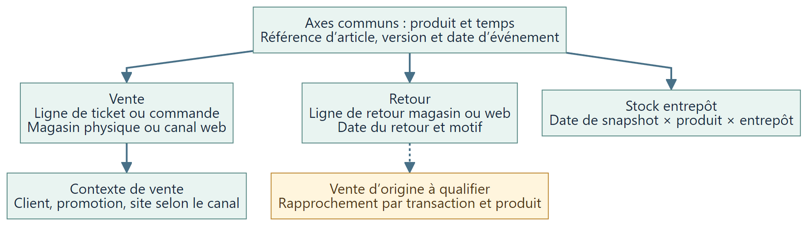

**Légende.** Les blocs résument les objets métier et leurs grains. Le lien de rapprochement en pointillé exprime une recherche à qualifier à partir de la transaction et de l’article.

| Objet d’analyse | Grain exploitable | Mesures ou attributs |
| --- | --- | --- |
| Ventes et retours | Une ligne physique qualifiée dans le canal | Quantité, montants, date d’événement, produit ; magasin/site selon rôle |
| En-tête de vente | Canal × numéro de ticket ou de commande | Date de vente, valeur et quantités du panier complet ; magasin si physique |
| Inventaire | Date × version produit × entrepôt | Quantité observée, complétude et zéro observé |
| Clic | Une ligne d’événement observée | Date, heure, produit, page, client facultatif |
| Avis et prix du marché | Un avis par clé ; une observation prix par imp_sk | Note ou prix, date ou validité, produit ; concurrent dans le flux prix |

Le modèle distingue produit technique et identifiant métier, puis date de vente, de retour, d’expédition et de snapshot. Les rôles vendeur, point de vente et entrepôt ont des domaines différents. L’inventaire d’entrepôt n’est pas regroupé avec les magasins. [P04–P06]

<!-- page: UC-02 · Modèle dimensionnel -->
# Relations du modèle en étoile

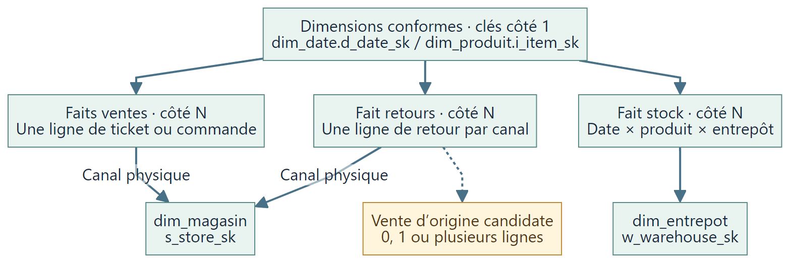

**Légende.** Les liens pleins indiquent des axes corroborés sur les référentiels livrés. Les pointillés montrent la recherche d’une vente d’origine pour un retour. Le grain des ventes et retours reste la ligne physique, avec identifiant de lot et de ligne.

## Étoile retenue pour Gold

Les dimensions Date et Produit alimentent ventes, retours et stocks. Dans chaque fait, une dimension joue le rôle de la date de l’événement. Magasin filtre les ventes et retours physiques. Entrepôt est l’axe de stock et peut aussi qualifier une ligne de vente web lorsque le KPI utilise son rôle d’expédition. Les client, promotion, site et motif sont ajoutés selon les rôles validés.

La dimension Produit peut dénormaliser catégorie, classe et marque à partir des attributs de `item`. La dimension Client peut dériver des attributs agrégés d’adresse et de démographie pour les usages autorisés. Les tables de référence gardent leurs grains Silver. Un flocon réduirait certaines redondances mais ajouterait des jointures aux parcours de BI les plus fréquents. [D3 diap. 22–31 ; P05]

<!-- page: UC-02 · Contrats Gold -->
# Grains et règles de publication Gold

| Jeu Gold | Clé et grain | Mesures et contrôles de publication |
| --- | --- | --- |
| f_vente_magasin / f_vente_web | Ligne · lot, version du fichier, ordinal stable | Conserver quantités, net payé, catalogue étendu, taxes, coupons, remises et résultat source. Pour le web, garder les dates de vente et d’expédition. |
| f_transaction | Canal × identifiant d’en-tête dans la version publiée | Compter les en-têtes distincts. Préparer la somme du net payé et des unités du panier complet. Identifier les transactions exclues et leur motif. |
| f_retour | Ligne de retour · canal et provenance | Quantité et montant par date de retour. Conserver le champ perte à des fins de contrôle. Isoler le statut d’attribution à la vente sans multiplier les lignes. |
| f_stock | Date × item_sk × entrepôt | Contrôler le triplet. Conserver quantité, présence de mesure et indicateur zéro. Comparer les snapshots avec leur couverture. |
| Dimensions conformes | Une ligne par clé de référence | Date, produit, magasin et entrepôt. La date web joue deux rôles. Laisser distinctes les dates de vente, retour et inventaire. |
| Marts ventes, finance, retours et stocks | Jour × canal ou snapshot × entrepôt | Exposer sommes et effectifs. Recalculer les ratios avec le dénominateur du filtre visible. |
| Mart navigation et avis | Jour × page ou jour × produit | Séparer clics attribués, clics totaux, avis notés et total d’avis. Préserver les effectifs de contrôle. |

## Rejouer un lot et réconcilier les indicateurs

L’identifiant de provenance repose sur le fichier reçu et l’ordinal physique. Il permet de conserver plusieurs lignes avec le même couple achat–produit. La lecture distribuée par Spark doit préserver cet ordinal ou un offset stable. Le registre garde les identifiants de lot et de publication pour retrouver les résultats d’un calcul.

Les rapports de finance recalculent K08 et K14 à partir des sommes. Une vue d’en-têtes fournit K03, K04 et K21. Le mart stock expose les quantités observées, les zéros et la couverture à la même date. Les rapprochements de P09 servent de contrôle avant promotion. K12 et le comparatif K26 restent hors des marts métier. K16 reste une mesure de qualité de la source tant que la formule diverge.

Choisir les partitions sur les périodes de filtre et mesurer le nombre de fichiers produits. L’archivage par lot en Bronze reste indépendant des périodes de vente, de retour et de snapshot.

<!-- page: UC-02 · Gouvernance -->
# 11 · Accès et protection des données

| Principal / rôle | Périmètre cible | Contrôle prévu |
| --- | --- | --- |
| Service d’ingestion | Lecture du dépôt, écriture Bronze et de son journal | Identité dédiée, aucune lecture BI du brut. |
| Service de transformation | Lecture Bronze, écritures Silver / Gold et quarantaine | Droits par chemin et service. Publication sous identité identifiée. |
| Équipe Data | Catalogue, preuves et données nécessaires à l’investigation | Accès à la quarantaine sur habilitation et audit des accès. |
| Finance / Commerce | Marts Gold et définitions KPI approuvées | Identités ou groupes métier ; vues et agrégats adaptés. |
| Responsable magasin | Gold filtré sur les magasins autorisés | Filtrage dans la couche de restitution ou via vues autorisées. |
| Lecture logistique | Gold stock par entrepôt selon périmètre | Accès à la mesure et à la couverture, sans exposition client. |

## Sécurité de conception

- Authentifier les services séparément des personnes. Sur une cible multiutilisateur HDFS, étudier Kerberos et les ACL de chemins. Paramétrer TLS pour les communications pertinentes.
- Protéger les secrets par le mécanisme de paramètres sensibles ou un coffre adapté au service. Les configurations versionnées contiennent les références de secrets. Le renouvellement et la responsabilité sont documentés.
- Les noms, adresses et courriels ont des formes d’attributs personnels, même dans le jeu synthétique. Exposer les attributs strictement nécessaires, limiter les identifiants et éviter le texte ou les chaînes libres dans les journaux.
- Appliquer une rétention des versions et des rejets validée par le projet. Les preuves du Jour 1 contiennent les agrégats et des aperçus de formes masqués.

**Contrôle d’accès à vérifier.** Valider avec des identités de test qu’un lecteur Gold ne lit ni les fichiers bruts ni la quarantaine, et qu’un magasin n’ouvre pas le périmètre d’un autre magasin. Les ACL HDFS ou ADLS n’appliquent pas à elles seules un filtre de lignes dans un mart partagé.

<!-- page: UC-02 · Exploitation -->
# Lignage, qualité et exploitation

| Type de décision | Champ de traçabilité | Contrôle avant publication |
| --- | --- | --- |
| Origine et version | Lot, chemin, SHA-256, taille, schéma et date d’arrivée | Même empreinte et même périmètre ⇒ réception déjà connue. Chemin identique et nouvelle empreinte ⇒ version à arbitrer. |
| Préparation Silver | run_id, version du script, résultat par contrat, entrée et sortie | Lignes en entrée = lignes acceptées + lignes isolées selon politique ; conserver l’écart et son motif. |
| Relations et grains | Type, nullité, références absentes, clé cible, doublons | Clés critiques résolues et uniques. Quarantaine ou statut inconnu selon contrat. |
| Fraîcheur et couverture | Fenêtre métier, arrivée, publication, jours et entités couverts | Information de période partielle. Référentiels du refresh intégrés selon politique. |
| Publication et reprise | publication_id, versions Silver, version du dictionnaire, statut et horodatage | Manifeste publié en dernier. Les lecteurs retrouvent la dernière version cohérente. |
| Supervision | Volumes, temps, échecs, rejets, taux de couverture et source du seuil | Alerte sur échec, divergence de taille et baisse de couverture. Seuils métier à fixer sur une base observée. |

## Exploitation proposée

Un échec structurel retient le lot en Bronze et produit un motif exploitable. Une mesure manquante connue, comme une quantité de stock, se traite selon son contrat avec un compteur de couverture. Une rupture d’intégrité produit empêche la publication du périmètre concerné tant que le référentiel n’est pas complet. Les groupes d’accès et règles de rétention sont éprouvés pendant le pilote.

La reproductibilité associe versions des scripts, paramètres, empreintes d’entrées et sorties. Les données sources peuvent être relues pour recréer une version préparée. Le coût de relecture et d’espace temporaire se mesure lors du pilote, en particulier avant une stratégie de rétention de plusieurs versions.

<!-- page: UC-02 · Azure -->
# 12 · Architecture cible Azure

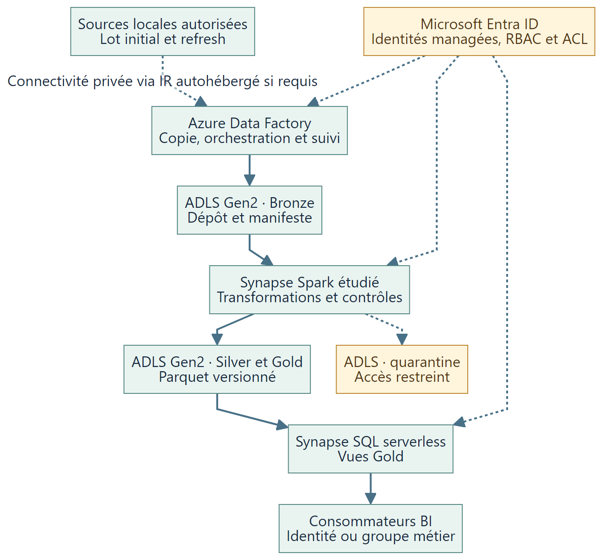

**Légende.** Le parcours continu représente la copie, la transformation et la consultation. Les liens pointillés portent la connectivité à confirmer, la quarantaine et les identités.

ADLS Gen2 utilise un compte de stockage avec espace de noms hiérarchique. La proposition sépare les systèmes de fichiers `bronze`, `silver`, `gold` et `quarantine` pour gérer les autorisations par zone. ADF orchestre les copies et lots. Un runtime autohébergé est étudié si le chemin d’entrée reste privé. Synapse Spark est étudié pour reproduire les transformations et Synapse SQL serverless pour interroger les Parquet Gold exposés, par exemple avec des vues sur `OPENROWSET`. [D5–D9, D11]

Chaque service reçoit une identité managée et des droits adaptés. Entra ID porte les identités et groupes. Les rôles de données RBAC à large portée peuvent déjà accorder un droit que les ACL ne viennent pas retirer. Les ACL servent aux chemins qui requièrent une granularité plus fine, avec droit de traversée sur les répertoires parents. Le réseau, les identités et l’autorisation SQL doivent être validés au J4. [D5–D7]

<!-- page: UC-02 · Local et cloud -->
# Correspondances, coûts et quotas

| Rôle | Local | Cible Azure | Condition de transposition |
| --- | --- | --- | --- |
| Collecte | NiFi batch et registre de lot | ADF Copy et pipelines, IR selon réseau | Même manifeste et mêmes clés d’idempotence |
| Stockage | HDFS, répertoires par zone | Compte ADLS Gen2 HNS et systèmes de fichiers | Convention de noms, ACL et version de publication |
| Transformation | PySpark + contrats Python | Synapse Spark étudié, jobs paramétrés | Rejouer les tests de typage, FK et précision DECIMAL |
| Exposition | SQL et BI sous Linux, moteur à choisir | Vues Synapse SQL serverless + BI | Confirmer lecture Parquet, mode Import et sécurité |
| Identité | Identités de services et groupes OS/HDFS | Microsoft Entra ID, identités managées, RBAC/ACL | Contrôler les accès par zone et identité |
| Suivi | Journaux NiFi, Spark, registre de contrôles | Suivi ADF et Synapse, Azure Monitor si activé | Conserver les mêmes identifiants, seuils et événements |
| Dépenses / limites | Matériel, disque, RAM, exploitation | Stockage, opérations, IR, Spark, scans SQL, logs et transferts | Budget et quotas à mesurer avant le pilote |

## Sécurité et seuils à préparer

Utiliser la connectivité privée et les restrictions de réseau selon les services retenus, valider les DNS et endpoints nécessaires, puis tester le chemin des identités managées. Utiliser Key Vault pour les secrets résiduels. Protéger les zones en lecture et écriture par des identités de test. Appliquer chiffrement au repos et TLS selon la configuration du service et ses connecteurs. [D5–D8]

Les principaux facteurs de coût sont les octets conservés, les transactions de stockage, les exécutions ADF, le calcul Spark, les octets traités par le SQL serverless, les transferts et la rétention des logs. Estimer **volume × prix stockage**, **activités × prix d’exécution**, **heures de calcul × tarif** et **volume SQL traité × tarif**, avec la région et le contrat retenus. La facturation serverless tient compte d’un minimum de **10 Mo traités par requête**. Contrôler le volume analysé et mesurer les coûts sur un pilote. [D9]

Avant tout pilote, vérifier les quotas de concurrence ADF, la capacité et les limites du compte ADLS, les vCores Spark disponibles et les limites de l’abonnement et de la région. Les budgets surveillent la dépense, et les limites de données traitées de Synapse contrôlent un poste précis. Aucun coût Azure réel ni quota propre à un abonnement n’a été mesuré au Jour 1. [D9–D10]

<!-- page: Vérification · Preuves -->
# Couverture du TP1 et preuves

| Élément obligatoire TP1 §8.1 | Pages | Preuve ou support |
| --- | --- | --- |
| 01 Fiche de cadrage métier | 4 | D1 et D2 |
| 02 Matrice utilisateurs et questions | 5–7 | P07 · Figure 1 |
| 03 Dictionnaire initial des KPI | 8–13 | Classeur KPI, [P04–P06 p. 42–44](#p42) et P09 |
| 04 Inventaire réel TPCx-BB | 14–18 | Classeur d’inventaire, [P01–P03 p. 39–41](#p39) |
| 05 Qualification et relations | 19–22, 30–32 | Classeur qualité, [P04–P06 p. 42–44](#p42), P09 |
| 06 Limites et hypothèses | 23 | Registre H01–H15 et [P06 p. 44](#p44) pour K12 |
| 07 Comparaison des architectures | 24 | P08, classeur architecture |
| 08 Schéma logique cible | 25 | P08 · Figure 2 |
| 09 Schéma des flux | 26–27 | P08 · Figure 3 |
| 10 Matrice des composants | 28–29 | P08 · Figure 4 et classeur architecture |
| 11 Proposition de gouvernance | 33–34 | P08, règles d’accès et de publication |
| 12 Comparaison local / Azure | 35–36 | P08 · Figure 7 et tableau comparatif |

## Retrouver les résultats

- **P01–P03** Inventaire, schéma et aperçus masqués dans `01_inventaire.csv`, `01_profil.json`, `02_colonnes.csv` et `schema_tpc.json`.
- **P04–P06** Clés, relations, périodes et diagnostics de `03_cles.csv` à `07_diagnostics.csv`.
- **P07–P08** Schéma fonctionnel et six schémas du modèle et de l’architecture. Sources éditables sous `preuves/schemas/`.
- **P09** Valeurs et composantes par lot dans `11_kpi_valeurs.csv`, profil des mesures dans `12_kpi_champs.csv` et tests dans `13_kpi_controles.csv`. La commande et l’horodatage figurent dans `11_kpi_execution.json`.

Les six captures PowerShell figurent en [annexe A, pages 39 à 44](#p39). Chaque page indique le contrôle représenté, le résultat à retenir et le fichier de référence. Les PNG et les commandes d’affichage sont accessibles dans `preuves/captures/`.

<!-- page: Conclusion et sources -->
# Conclusion

Le jeu permet de suivre les ventes, les transactions et les paniers par canal, les volumes et montants de retour par date d’événement, ainsi que les niveaux de stock à une date donnée. Les contrôles de finance distinguent le résultat synthétique des ventes et la perte de retour telle qu’elle est enregistrée. Le délai d’expédition s’observe à la ligne web et les prix concurrents restent exploratoires.

L’architecture proposée conserve les lots d’origine et publie des marts au grain adapté. Gold réutilise les numérateurs, dénominateurs et effectifs de contrôle pour que les rapports gardent le même sens lorsqu’on filtre un canal, un mois ou un entrepôt. La cible Azure reprend ces contrats et cette organisation.

Les prochaines validations portent sur la provenance du kit, le sens du rafraîchissement, les conventions financières et la règle d’attribution des retours. Ces décisions déterminent les mesures qui peuvent être diffusées et les rapprochements qui restent réservés à l’exploration.

## Sources documentaires

- **D1.** IPSSI, *TP1.pdf*, §2–4 pour le scénario et la qualification, §5.1–5.2 pour les UC, §8.1 p. 22 pour les 12 éléments.
- **D2.** IPSSI, *projet_fil_rouge.pdf*, ch. 1–5 et 8 pour le contexte, les technologies, les couches et la gouvernance.
- **D3.** IPSSI, *Cours 1 .pdf*, diap. 9–32 et 39–52 pour BI, OLAP, ETL/ELT, modélisation et architectures.
- **D4.** TPC, *TPCx-BB Standard Specification, v1.7.0*, juin 2025, annexes B et G. Règles des ventes et retours p. 81–87. [Spécification officielle](https://www.tpc.org/TPC_Documents_Current_Versions/pdf/TPCX-BB_v1.7.0.pdf)
- **D5.** Microsoft Learn, modèle d’accès et ACL de stockage. [Modèle d’accès ADLS](https://learn.microsoft.com/azure/storage/blobs/data-lake-storage-access-control-model) · [ACL](https://learn.microsoft.com/azure/storage/blobs/data-lake-storage-access-control)
- **D6.** Microsoft Learn, identités managées ADF. [Documentation Microsoft Entra et ADF](https://learn.microsoft.com/azure/data-factory/data-factory-service-identity)
- **D7.** Microsoft Learn, connecteur ADLS Gen2. [Copie et transformation](https://learn.microsoft.com/azure/data-factory/connector-azure-data-lake-storage)
- **D8.** Microsoft Learn, types d’Integration Runtime. [IR ADF et Synapse](https://learn.microsoft.com/azure/data-factory/concepts-integration-runtime)
- **D9.** Microsoft Learn, coûts du pool SQL serverless. [Données traitées et limites](https://learn.microsoft.com/azure/synapse-analytics/sql/data-processed)
- **D10.** Microsoft Learn, quotas d’abonnement et services. [Limites Azure](https://learn.microsoft.com/azure/azure-resource-manager/management/azure-subscription-service-limits)
- **D11.** Microsoft Learn, lecture de fichiers Parquet sur Synapse SQL serverless. [Requêtes Parquet](https://learn.microsoft.com/azure/synapse-analytics/sql/query-parquet-files)

<!-- page: Annexe A · P01 -->
# P01 · Inventaire des deux lots

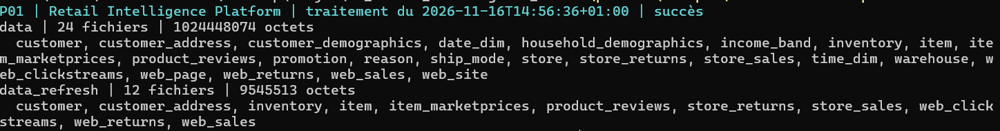

## Lire le décompte

`data` contient **24 fichiers** pour **1 024 448 074 octets**. `data_refresh` contient **12 fichiers** pour **9 545 513 octets**. Les noms qui se poursuivent à la ligne sont des retours automatiques du terminal. Le décompte porte sur les fichiers, y compris les rapports CSV. Les lignes sous chaque lot énumèrent les répertoires de tables.

**Référence de vérification** `01_inventaire.csv` et `01_profil.json`. Voir l’inventaire UC-01, pages 14 à 17.

<!-- page: Annexe A · P02 -->
# P02 · Colonnes des ventes magasin

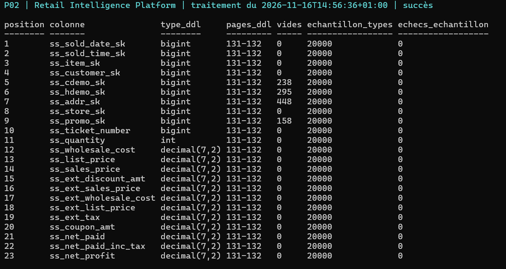

## Lire les positions et les types

Les **23 colonnes** sont affichées dans l’ordre du fichier. Le ticket `ss_ticket_number` occupe la position **10** et le net payé `ss_net_paid` la position **21**, au format `decimal(7,2)`. Le contrôle lexical des **20 000 premières lignes** ne remonte aucune erreur de type par colonne. La colonne `vides` indique les occurrences comptées sur le fichier entier.

**Référence de vérification** `02_colonnes.csv` pour `data/store_sales` et DDL TPCx-BB p. 131–132. Voir les pages 14 et 18.

<!-- page: Annexe A · P03 -->
# P03 · Largeur et champs vides

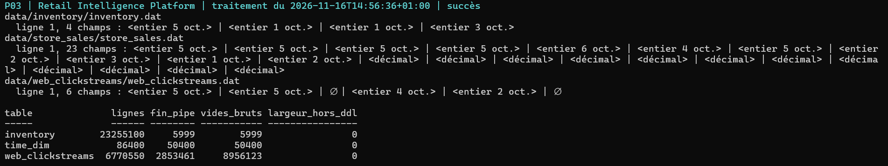

## Conserver les champs terminaux

Les aperçus montrent **4 champs** pour `inventory`, **23** pour `store_sales` et **6** pour `web_clickstreams`. Le tableau de contrôle affiche zéro ligne hors largeur DDL pour les trois tables listées, `inventory`, `time_dim` et `web_clickstreams`. Dans `time_dim`, **50 400** lignes se terminent par le séparateur signalant le dernier champ vide. Dans le tableau, `vides_bruts` compte les champs vides, et `fin_pipe` compte des lignes.

**Référence de vérification** `01_profil.json`, aperçus masqués et compteurs de structure. Voir les pages 16 et 18–19.

<!-- page: Annexe A · P04 -->
# P04 · Unicité et répétitions de clés

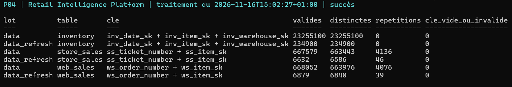

## Interpréter la colonne « repetitions »

La différence entre lignes à clé valide et clés distinctes donne les lignes au-delà de la première occurrence de chaque clé. Dans le lot initial, elle vaut **4 136** pour le couple ticket–article et **4 076** pour le couple commande–article. Dans le refresh, elle vaut **46** et **39**. Le triplet date–article–entrepôt du stock reste unique dans chaque lot.

Un contrôle séparé de la ligne complète trouve **zéro doublon exact** dans les quatre fichiers de ventes. Les répétitions du couple sont donc insuffisantes pour retirer des lignes de vente. K03 se calcule à partir des identifiants d’en-tête, par canal.

**Référence de vérification** `03_cles.csv` pour le grain candidat et `07_diagnostics.csv` pour les doublons exacts. Voir les pages 8, 11 et 20–22.

<!-- page: Annexe A · P05 -->
# P05 · Références résolues par le refresh

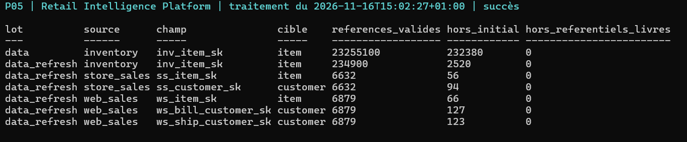

## Comparer les périmètres de référence

Dans le stock initial, **232 380 lignes** portent une clé produit absente du seul référentiel initial. Le compteur tombe à **zéro** lorsque les référentiels livrés sont réunis. Le même contrôle repère **2 520 références** produit hors initial dans le stock refresh. La qualification des ventes rafraîchies et du stock dépend donc du périmètre du référentiel examiné.

**Référence de vérification** `04_relations.csv`, colonnes `hors_initial` et `hors_referentiels_livres`. Voir les pages 11 et 20–22.

<!-- page: Annexe A · P06 -->
# P06 · Retours et contrôles de mesures

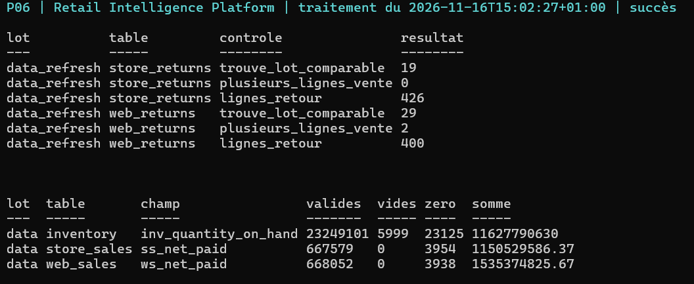

## Justifier la suspension de K12

Seuls **19 retours magasin sur 426** et **29 retours web sur 400** trouvent au moins une vente candidate. **Deux des 29 retours web** ont plusieurs correspondances. Une clé de ligne d’origine, une règle de traitement des retours successifs et une fenêtre de maturité sont nécessaires pour calculer un taux par cohorte. K12 reste suspendu.

Le tableau inférieur distingue **5 999 quantités de stock vides** et **23 125 quantités à zéro** dans le lot initial. Le total de contrôle porte sur toutes les dates. K07 utilise une date de snapshot. Les deux sommes de net payé concordent avec le contrôle par canal de la page 19.

**Référence de vérification** `07_diagnostics.csv` pour les retours et `06_mesures.csv` pour les montants et quantités. Voir les pages 10, 19 et 21.
