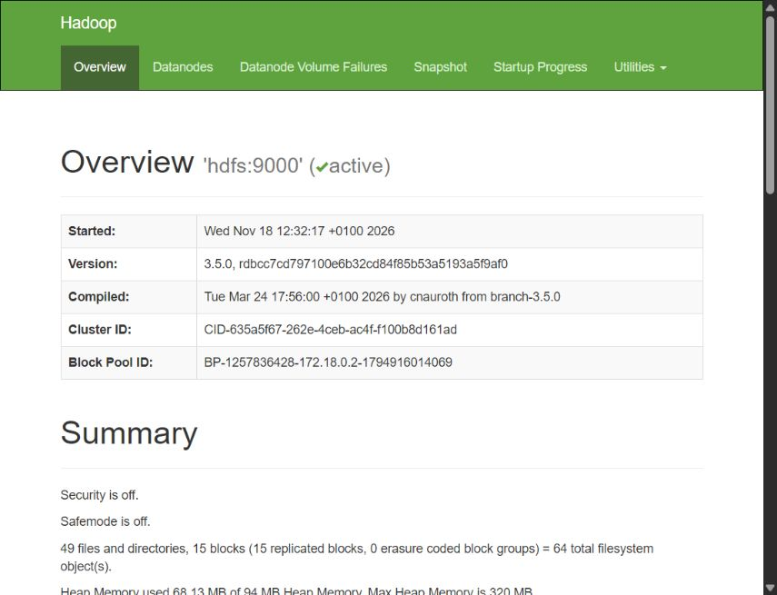
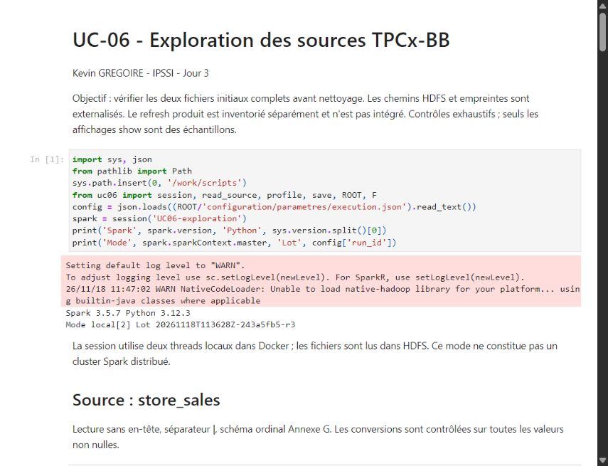
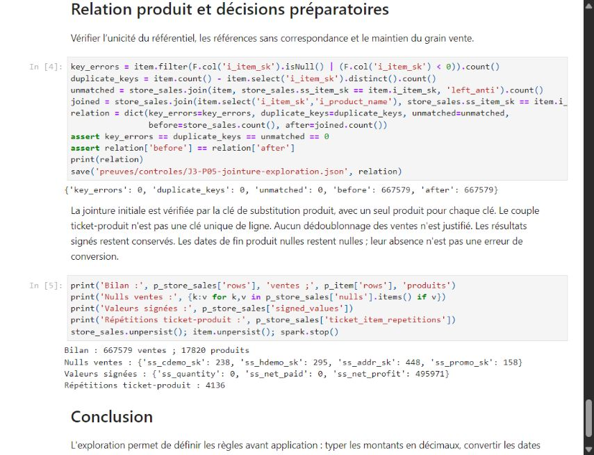

# DAT Retail Intelligence Platform - Jour 3

## UC-06 - Transformation, qualité et organisation des données

Kevin GREGOIRE - IPSSI - Mastère Développement, Data & IA

18 novembre 2026 - Rapport d'exécution et de synthèse

## Bilan vérifié

Deux fichiers initiaux TPCx-BB complets ont été traités par PySpark, à partir de copies Raw dans HDFS. Silver contient 667 579 lignes de ventes et 17 820 produits ; Gold contient 17 820 agrégats produit. Les fichiers Parquet Snappy ont été écrits, relus et contrôlés. Les sommes sont de 33 755 474 unités et 1 150 529 586,37 unités monétaires de net payé. Le notebook comporte cinq cellules code exécutées sans erreur.

Le registre comprend 73 contrôles de transformation, sans échec bloquant, avec des anomalies documentées. Les 2 575 corrections produit concernent uniquement des espaces périphériques. Aucun rejet ni dédoublonnage n'a été appliqué. Les 495 971 profits négatifs sont conservés. La jointure n'a ni perdu ni multiplié les lignes.

Le lot final validé est 20261118T113628Z-243a5fb5-r3. Les deux tentatives de comparaison interrompues restent conservées et ne constituent pas des sorties valides. Les onze livrables de la section 10.2 sont disponibles ; leur couverture est détaillée en fin de rapport et dans verification/suivi_exigences.md.

## Périmètre et méthode

Ce travail couvre uniquement les dix étapes UC-06 de la section 4, les tests de la section 8, les livrables des sections 4.15/10.2 et les dix questions de la section 11. Le TP3 (56 pages) et le Cours 3 (70 pages) ont été lus intégralement. Le TP est prioritaire. Les documents J1 et J2 ont été relus pour les besoins métier et la continuité HDFS. Les extractions lisibles sont conservées dans preuves/consignes.

Le DAT J1 place les unités vendues par produit (Q03/K02) et le net payé (Q05/K01) parmi les besoins de préparation analytique. J2 avait déposé reason.dat dans HDFS et préparé les zones sans les alimenter. J3 réutilise ce stockage, préserve les dépôts et apporte les transformations. Les chiffres actuels sont recalculés ; les anciennes notes ne sont pas utilisées comme preuve de l'état courant.

UC-05, installation HBase, défis Lakehouse, formats transactionnels supplémentaires, déploiement Azure et BI Jour 4 sont exclus. Aucune installation de cluster Spark distribué n'a été réalisée. Les sources, fichiers pédagogiques et livrables J1/J2 sont préservés ; aucun formatage ni suppression de volume n'a été lancé.

## Disponibilité des données dans la remise

Les véritables fichiers Parquet Silver et Gold du lot final sont fournis dans donnees_produites/export et dans A_REMETTRE_J3, avec les neuf SHA-256 HDFS/Windows, les schémas et les comptages contrôlés. Leur relecture locale par Spark a réussi sans accès HDFS. Les résultats et analyses ci-dessous sont inchangés.

---

# Fiche environnement

Exécution le 18 novembre 2026 (Europe/Paris). Les journaux Docker utilisent UTC, soit une heure de moins à cette date. Les identifiants de lots portent l'heure UTC.

| Composant | Valeur observée |
|---|---|
| Hôte | Windows 11 Professionnel 10.0.26200 ; 16 380 056 Kio de RAM totale |
| Virtualisation | WSL2, distribution docker-desktop ; moteur Linux Docker Desktop |
| Docker Desktop / Engine | 4.84.0 / 29.6.2 |
| Ressources du moteur | 16 processeurs visibles ; 8 126 324 736 octets de RAM |
| Conteneur Spark | retail-j3-spark ; limite 4 Gio et 4 CPU ; aucun port publié |
| Système Spark | Ubuntu 24.04.4 LTS ; image existante retail-j2-hadoop:3.5.0 |
| Python traitement | 3.12.3 ; /tmp/retail-j3-venv/bin/python |
| Java traitement | Temurin OpenJDK 17.0.18, déjà installé dans l’image J2 |
| Spark / PySpark / Py4J | 3.5.7 / 3.5.7 / 0.10.9.7 |
| Hadoop serveur / client Spark | 3.5.0 / 3.3.4 embarqué ; accès RPC réellement testé |
| Mode Spark | local[2], driver 1 536 Mio, shuffle 4 partitions, UI désactivée |
| Notebook | nbclient 0.10.4, nbformat 5.10.4, ipykernel 6.31.0 ; nbconvert 7.16.6 |
| Jupyter interactif | Pas de serveur JupyterLab installé ; notebook exécuté par nbclient |
| HDFS | hdfs://hdfs:9000, NameNode et DataNode dans retail-j2-hdfs-1 ; un DataNode vivant |
| HDFS stockage | Volumes retail-j2_namenode et retail-j2_datanode conservés ; réplication J3 à 1 |
| NiFi | Conteneur J2 existant, resté arrêté ; aucune modification de configuration |
| Windows Java / Python rapport | Java 21.0.2 non utilisé pour Spark ; Python fourni 3.12.14 pour documentation |

## Validation réelle

J3-P02 prouve la lecture HDFS de reason.dat, 35 lignes, printSchema, trim, écriture et relecture Parquet. Les traitements complets J3-P06 et la relecture autonome J3-P10 confirment ensuite le fonctionnement sur les données retenues. L'avertissement NativeCodeLoader indique l'utilisation des classes Java de remplacement ; il n'a pas empêché les écritures ni les relectures.

## Réparation minimale autorisée

Le dossier J2 est actuellement sous J1. Le conteneur existant pointait vers l'ancien chemin Projet/J2_Retail_Intelligence_Ingestion/installation/hadoop. Docker y avait créé deux dossiers vides portant les noms des XML. Après autorisation explicite de l'utilisateur, ces deux dossiers vides ont été déplacés dans configuration/restauration_montages et remplacés par des copies identiques des XML actuels. Les fichiers originaux et les volumes n'ont pas été modifiés par cette réparation. Le NameNode et le DataNode existants ont ensuite été démarrés. Le mode sûr de démarrage s'est désactivé automatiquement. Aucun formatage n'a été lancé.

Les deux fichiers reason.dat J2 sont contrôlés par SHA-256 avant et après le travail. Les autres fichiers pédagogiques, J1/J2 et sources Windows sont protégés par un manifeste de 158 fichiers de contenu, avec 173 métadonnées Git recensées séparément.

## Références techniques

Compatibilité Java 17 / Python 3.8+ vérifiée dans la documentation officielle [Spark 3.5.7](https://spark.apache.org/docs/3.5.7/) et [Installation PySpark 3.5.7](https://spark.apache.org/docs/3.5.7/api/python/getting_started/install.html). Le client Hadoop embarqué n'est pas remplacé par les bibliothèques du serveur. La compatibilité utilisée ici est démontrée par les tests HDFS ; cela ne vaut pas certification de toutes les fonctionnalités Hadoop.

---

# Inventaire technique des sources

Les deux sources de traitement sont des données structurées : store_sales et item, lot initial complet. Aucun échantillonnage du traitement. Le refresh item a été examiné séparément pour lever l'incertitude sur la couverture, puis exclu du pipeline. Il contient 180 lignes, clés 17 820 à 17 999 ; toutes les ventes initiales utilisent 0 à 17 819, déjà présents dans item initial.

## Localisation vérifiée

Racine du kit sur Windows :

C:\Users\Kevin GREGOIRE\Desktop\Projet\01. Architecture DataLake, DataWarehouse, Lakehous\retail_project\retail_project

Montage en lecture seule dans Spark : /sources. Racine des nouveaux dépôts HDFS :

hdfs://hdfs:9000/retail-lake/raw/j3/20261118T113628Z-243a5fb5

| Source / lot | Lignes et champs | Octets | Granularité |
|---|---|---|---|
| data/store_sales | 667 579 / 23 | 92 764 700 | Ligne de vente magasin |
| data/item | 17 820 / 22 | 6 799 286 | Enregistrement produit par clé de substitution |
| data_refresh/item | 180 / 22 | 69 173 | Enregistrement produit par clé de substitution |

Format vérifié sur toutes les lignes : DAT texte délimité par |, sans en-tête, fins CRLF. Le décodage UTF-8 strict réussit et aucun octet non ASCII n'est rencontré : ASCII est compatible UTF-8 ; on ne peut pas distinguer davantage les encodages compatibles sur ce contenu. Le split conserve les derniers champs vides. Chaque ligne retenue a exactement 23 ou 22 champs ; aucun séparateur terminal surnuméraire n'est retiré arbitrairement.

## Schéma ordinal fiable

Les positions ci-dessous proviennent du DDL des tables temporaires Hive de l'Annexe G de TPCx-BB 1.7.0, pages 125 et 131-132. Le dictionnaire de J1 a été recopié puis revalidé contre une nouvelle copie du PDF officiel dans preuves/consignes. La section B.1 n'a pas servi à supposer l'ordre physique. La version exacte du générateur du kit local reste inconnue ; la largeur, le typage, les relations et les égalités de montants corroborent la correspondance.

Référence : [TPCx-BB 1.7.0, juin 2025](https://www.tpc.org/TPC_Documents_Current_Versions/pdf/TPCX-BB_v1.7.0.pdf). Le script verification/verifier_reference.py conserve l'empreinte du PDF et vérifie les deux listes ordinales.

## Dictionnaire store_sales

| Position physique | Colonne | Type Raw interprété / Silver |
|---|---|---|
| 1 | ss_sold_date_sk | bigint |
| 2 | ss_sold_time_sk | bigint |
| 3 | ss_item_sk | bigint |
| 4 | ss_customer_sk | bigint |
| 5 | ss_cdemo_sk | bigint |
| 6 | ss_hdemo_sk | bigint |
| 7 | ss_addr_sk | bigint |
| 8 | ss_store_sk | bigint |
| 9 | ss_promo_sk | bigint |
| 10 | ss_ticket_number | bigint |
| 11 | ss_quantity | int |
| 12 | ss_wholesale_cost | decimal(7,2) |
| 13 | ss_list_price | decimal(7,2) |
| 14 | ss_sales_price | decimal(7,2) |
| 15 | ss_ext_discount_amt | decimal(7,2) |
| 16 | ss_ext_sales_price | decimal(7,2) |
| 17 | ss_ext_wholesale_cost | decimal(7,2) |
| 18 | ss_ext_list_price | decimal(7,2) |
| 19 | ss_ext_tax | decimal(7,2) |
| 20 | ss_coupon_amt | decimal(7,2) |
| 21 | ss_net_paid | decimal(7,2) |
| 22 | ss_net_paid_inc_tax | decimal(7,2) |
| 23 | ss_net_profit | decimal(7,2) |

## Dictionnaire item

| Position physique | Colonne | Type Raw interprété / Silver |
|---|---|---|
| 1 | i_item_sk | bigint |
| 2 | i_item_id | string |
| 3 | i_rec_start_date | string ISO / date |
| 4 | i_rec_end_date | string ISO / date |
| 5 | i_item_desc | string |
| 6 | i_current_price | decimal(7,2) |
| 7 | i_wholesale_cost | decimal(7,2) |
| 8 | i_brand_id | int |
| 9 | i_brand | string |
| 10 | i_class_id | int |
| 11 | i_class | string |
| 12 | i_category_id | int |
| 13 | i_category | string |
| 14 | i_manufact_id | int |
| 15 | i_manufact | string |
| 16 | i_size | string |
| 17 | i_formulation | string |
| 18 | i_color | string |
| 19 | i_units | string |
| 20 | i_container | string |
| 21 | i_manager_id | int |
| 22 | i_product_name | string |

## Clés et anomalies

ss_item_sk et i_item_sk sont des bigint / long et représentent la clé de substitution produit. i_item_sk est unique et non nul : 17 820 clés pour 17 820 lignes ; le minimum est zéro. Les 667 579 références de vente sont rapprochées sans ambiguïté. ss_ticket_number × ss_item_sk présente 4 136 répétitions au-delà de la première occurrence ; il ne constitue pas une clé unique de ligne. Aucun doublon exact n'a été constaté, avec deux méthodes exhaustives (empreintes de lignes Python et distinct Spark). La clé i_item_id est conservée mais n'est pas utilisée pour la jointure.

Les colonnes ventes sont numériques : identifiants, quantité entière, 12 montants decimal(7,2). Aucun champ temporel calendaire n'est directement présent dans store_sales ; les clés de date et d'heure restent des références. item contient 8 colonnes numériques et 14 chaînes à la lecture, dont deux dates ISO converties en Silver.

Les listes de nulls, extrema, domaines et empreintes sont conservées dans inventaire_python.json et J3-P04-*.json. Les valeurs atypiques et champs manquants sont détaillés dans le rapport qualité. Les valeurs Unknown et N/A du référentiel restent des libellés sources, pas des nulls inventés.

---

# Règles de nettoyage UC-06

Règles définies après exploration et avant lancement du traitement Silver/Gold. Périmètre : fichiers initiaux complets store_sales et item. Les résultats d'application sont enregistrés dans J3-P06-transformation.json.

| ID | Champs / constat et contrôle exhaustif | Décision et transformation | Justification et limite |
|---|---|---|---|
| R01 | Tous : ordre physique, 23 champs vente et 22 produit, sans en-tête | Schéma Annexe G, lecture de chaînes puis try_cast contrôlé. Arrêt si conversion non nulle impossible | Ne pas perdre silencieusement une valeur. Le manifeste du générateur local n'est pas livré |
| R02 | Montants : decimal(7,2), contrôles prix × quantité et net + taxe | Conserver les décimaux, SUM élargit la précision ; aucune conversion en flottant | Éviter les erreurs d'arrondi et le double comptage. Devise inconnue |
| R03 | ss_item_sk / i_item_sk, ticket, quantité et net payé : présence et domaine | Isoler les identifiants négatifs ou nuls et les mesures nécessaires nulles ; sauvegarder tout rejet avec motif | Zéro est une clé réelle du kit ; ne pas l'invalider. Une mesure signée n'est pas un rejet |
| R04 | Dates produit : chaînes ISO, contrôles try_cast et ordre début/fin | Convertir en date ; conserver les fins nulles ; arrêter si date non vide invalide ou fin antérieure au début | Aucune date de fin inventée. Les *_date_sk de vente restent des références numériques |
| R05 | Textes produit : comparaison valeur / trim | Retirer seulement les espaces périphériques ; compter les lignes modifiées | Ne pas modifier la casse, les libellés internes ou les catégories sans règle métier |
| R06 | Nulls facultatifs ventes et produits, y compris fins produit absentes | Conserver NULL ; aucune imputation | Absence ne signifie pas zéro. Les taux sont mesurés par colonne |
| R07 | Ventes : 0 doublon exact, 4 136 répétitions au-delà du premier couple ticket-produit | Conserver toutes les lignes ; aucune déduplication | Le couple candidat n'identifie pas une ligne unique. Aucune clé de ligne native démontrée |
| R08 | 495 971 lignes avec résultat financier négatif | Conserver les valeurs signées, mesurer leur nombre | La négativité ne prouve pas une erreur. Ne pas transformer le résultat du kit en rentabilité réelle |
| R09 | Dimension : unicité i_item_sk ; ventes : références sans correspondance | Vérifier avant jointure ; arrêt si clé produit dupliquée ; jointure gauche, conserver les non rapprochés et mesurer | Empêcher la multiplication des ventes ; pas de rapprochement sur un libellé |
| R10 | Lots initial / refresh distincts | Ne traiter que l'initial ; conserver l'inventaire du refresh séparément | L'initial couvre toutes les références de vente retenues. Aucune sémantique de fusion supposée |

Les conversions de représentation ne sont pas présentées comme des corrections métier. Le bilan distingue lignes acceptées, lignes dont un texte est corrigé et lignes mises à l'écart. Une anomalie nouvelle bloquante laisse les sources intactes et ne produit aucun résultat déclaré valide.

---

# Modèle Silver et Gold

## Question métier et continuité

Le DAT J1, partie 2, Q03, demande quels produits se vendent le plus par canal (K02, unités vendues). Q05 et K01 définissent le net payé des ventes avant retours. Le Jour 3 prépare cette lecture pour le canal magasin initial : quels produits cumulent les quantités et montants nets les plus importants ? Il ne reproduit pas les 27 KPI. Le stockage HDFS de J2 est réutilisé ; NiFi n'est pas requis pour ce traitement.

## Chaîne exécutée

Sources Windows en lecture seule, contrôles physiques Python, nouvelles copies Raw HDFS vérifiées par SHA-256, exploration PySpark, règles écrites, conversions et normalisation, Silver Parquet relu, jointure contrôlée, agrégation, Gold Parquet relu, réconciliation indépendante et contrôles finaux.

## Silver

store_sales : les 23 colonnes natives typées, sans déduplication, plus _source_uri, _source_sha256, _source_batch, _run_id. Grain : une ligne du fichier de ventes, qui peut partager son couple ticket-produit avec une autre ligne distincte. 667 579 lignes acceptées, zéro rejet et zéro correction de texte ; toutes les lignes sont typées et tracées.

item : 22 colonnes natives, textes trim, dates de validité converties en date, mêmes quatre colonnes de provenance. Grain : un enregistrement par i_item_sk dans ce lot. 17 820 lignes acceptées, dont 2 575 corrigées uniquement pour espaces périphériques et 15 245 sans cette correction ; zéro rejet. Les 17 820 dates de début sont harmonisées en date ; les fins nulles restent nulles.

Chaque ligne acceptée est conservée. Les rejets, s'il en existe sur un autre lot, sont écrits dans quality/j3 avec un motif. Aucun fichier de rejets vide artificiel n'est créé pour cette exécution.

## Jointure et calcul

Jointure gauche : store_sales.ss_item_sk = item.i_item_sk. Relation plusieurs-vers-un, attendue et vérifiée. Types long, dimension unique, aucune clé requise nulle. Avant : 667579 ; après : 667579 ; sans correspondance : 0. Le grain de vente est conservé avant agrégation. L'enrichissement est une étape intermédiaire, sans troisième Silver artificiel.

## Gold : ventes_par_produit

Grain final : une ligne par clé de substitution produit du lot initial, dans le canal magasin. La clé n'est pas assimilée à une gamme ni à un produit commercial durable à travers toutes ses versions. Dimensions : ss_item_sk, i_product_name, i_category, i_brand. Ces attributs sont fonctionnellement dépendants de la clé dans le référentiel vérifié.

| Mesure | Formule | Type observé |
|---|---|---|
| quantity_sold | SUM(ss_quantity) | bigint / long |
| net_paid | SUM(ss_net_paid) | decimal(17,2) |
| sales_line_count | COUNT(*) | bigint / long |

Trois colonnes de traçabilité : _run_id, _source_sales_sha256, _source_item_sha256. Aucun filtre de signe ni remplacement des nulls facultatifs. Les lignes rejetées selon R03 seraient exclues de Gold, mais leur nombre est zéro ici. Aucun calcul de prix unitaire moyen, taux de retour ou résultat net réel de l'entreprise n'est ajouté.

Sorties validées :

- hdfs://hdfs:9000/retail-lake/silver/j3/20261118T113628Z-243a5fb5-r3/store_sales
- hdfs://hdfs:9000/retail-lake/silver/j3/20261118T113628Z-243a5fb5-r3/item
- hdfs://hdfs:9000/retail-lake/gold/j3/20261118T113628Z-243a5fb5-r3/ventes_par_produit

Seul le lot 20261118T113628Z-243a5fb5-r3 est la publication complète validée. Les deux essais précédents ne contiennent que Silver ventes et ne doivent pas être lus avec un glob englobant tous les lots.

## Limites

Les montants sont exprimés en unités monétaires du kit, sans devise attestée. Le net payé est avant retours, sans déduire une seconde fois coupons ou remises déjà pris en compte. L'agrégat est descriptif sur le lot initial et ne constitue ni chiffre d'affaires réel d'une enseigne ni benchmark officiel. Aucun calendrier n'est joint ; aucune période civile nouvelle n'est déduite des clés numériques de vente. Les lots refresh ne sont pas fusionnés.

---

# Résultats analytiques constatés

| Mesure sur les ventes initiales magasin | Résultat |
|---|---|
| Lignes de vente | 667 579 |
| Unités vendues | 33 755 474 |
| Net payé, unités monétaires du kit | 1 150 529 586,37 |
| Clés produit représentées | 17 820 |

Classement décroissant du net payé ; égalités départagées par clé produit. Les noms du kit sont synthétiques ; la clé stable permet le contrôle.

| Rang / clé produit | Quantité | Net payé (UM) | Lignes |
|---|---|---|---|
| 1 / 10000 | 454 954 | 15408393.55 | 9 029 |
| 2 / 10003 | 439 086 | 14933870.10 | 8 761 |
| 3 / 10001 | 420 138 | 14572124.66 | 8 269 |
| 4 / 10002 | 377 027 | 12817437.86 | 7 505 |
| 5 / 17502 | 94 625 | 3336529.83 | 1 878 |
| 6 / 10579 | 91 179 | 3250367.57 | 1 767 |
| 7 / 8601 | 89 600 | 3238749.92 | 1 761 |
| 8 / 5618 | 95 677 | 3212955.42 | 1 867 |
| 9 / 2651 | 88 936 | 3172287.79 | 1 730 |
| 10 / 16513 | 91 710 | 3162636.37 | 1 817 |

Le premier produit est la clé 10 000 : 454 954 unités, 15 408 393,55 UM et 9 029 lignes. Ce classement décrit le kit initial ; il ne suffit pas à recommander un assortiment réel. Tous les totaux et chacune des 17 820 lignes produit ont été rapprochés d'un groupement Python indépendant utilisant Decimal, sans pandas. Zéro écart de quantité, de montant ou de nombre de lignes.

---

# Comparaison des formats et contrôle Parquet

DAT est ici du texte délimité, comparable à un CSV sans en-tête. JSON est étudié et utilisé pour paramètres, contrôles et traces ; il n'est pas présenté comme une source native des ventes.

| Critère | DAT / CSV | JSON | Parquet |
|---|---|---|---|
| Organisation | Enregistrements en lignes, séparateur  /  | Objets et tableaux | Colonnes binaires |
| Types | Schéma externe à appliquer | Types primitifs, date et Decimal à encadrer | Types persistés dans le fichier |
| Compression | Sources non comprimées | Traces lisibles non comprimées | Snappy effectivement utilisé |
| Lisibilité | Lecture humaine possible | Lecture humaine possible | Lecture via Spark ou outil Parquet |
| Analyse | Parsing et scans texte | Adapté aux structures imbriquées | Projection de colonnes et agrégations |
| Limite | En-tête absent ; ordre à prouver | Plus verbeux ; pas de Decimal natif universel | Binaire ; gestion de table à organiser |

## Volumes réellement mesurés

| Jeu | Texte source (octets) | Parquet (octets) | Lignes relues |
|---|---|---|---|
| Silver ventes | 92764700 | 34766704 | 667579 |
| Silver produits | 6799286 | 3571219 | 17820 |
| Gold par produit | Pas de texte équivalent exporté | 1307151 | 17820 |

Pour Silver ventes, Parquet représente 37,48 % du volume DAT ; pour Silver produits, 52,52 %. Ces rapports comparent les sources aux sorties typées, avec provenance et normalisation ajoutées : ce n'est pas une expérience de compression à schéma strictement identique, ni un test de vitesse. La réduction Gold reflète surtout l'agrégation ; on ne l'attribue pas à la compression seule. Les volumes HDFS sont logiques, hors métadonnées du système de fichiers ; réplication 1.

## Vérifications exécutées

Pour chacune des trois sorties : écriture errorifexists, fichiers part-*.snappy.parquet et marqueur _SUCCESS présents, relecture Spark, égalité des noms et types, nombre de lignes avant/après identique. Les schémas complets avant et après sont dans J3-P08-parquet.json. Les champs de provenance déclarés non nullables par les expressions peuvent devenir nullables après lecture Parquet ; cette différence de métadonnée est documentée, pas masquée.

Deux sommes de fragments d'empreinte SHA-256 de chaque ligne sérialisée, incluant les nulls, sont calculées avant et après relecture. Elles sont égales pour les trois sorties et tiennent compte des multiplicités de lignes. Ce contrôle probabiliste n'est pas une preuve mathématique d'identité de tous les enregistrements ; il comporte un risque théorique de collision. Les sommes métier sont contrôlées séparément, dont une réconciliation indépendante pour chaque produit.

## Incident et correction

Les deux premières tentatives de contrôle par exceptAll restent en attente avec des tâches non terminées ; les lectures simples fonctionnent. Les journaux et états de threads sont conservés. Désactiver l'optimisation adaptative n'a pas résolu le problème et n'a pas été retenu. Le contrôle a été remplacé par schémas, volumes, empreintes agrégées et réconciliations métier, puis exécuté avec succès. La cause interne exacte du blocage n'est pas déterminée. Les sorties d'essai sont conservées et identifiées comme non validées ; aucune n'est écrasée.

## Garanties

Parquet stocke des fichiers typés en colonnes. Il ne fournit pas, à lui seul, de transactions multi-fichiers ACID, d'upsert métier, de contrôle de concurrence ni d'historique de table. Les lots uniques et errorifexists évitent nos écrasements, mais ne constituent pas une couche transactionnelle. Aucune installation Delta, Iceberg ou Hudi n'a été réalisée.

---

# Rapport qualité

Périmètre exhaustif : deux fichiers initiaux, 667 579 lignes ventes et 17 820 lignes produit, puis trois sorties relues. Les affichages de cinq ou dix lignes sont uniquement des aperçus. Le registre détaillé est disponible dans preuves/controles/registre_qualite.csv et J3-P09-qualite.json : identifiant, règle, cible, résultat numérique, attendu, statut, méthode, justification et limites.

## Bilan des contrôles

73 contrôles enregistrés : 64 OK, 8 OBSERVE, 1 ANOMALIE_DOCUMENTEE. Zéro contrôle bloquant en échec ne signifie pas absence d'anomalies. Les valeurs nulles facultatives et la non-unicité du couple ticket-produit restent explicitement signalées.

| Dimension | Résultat exécuté | Décision |
|---|---|---|
| Complétude | Nulls par colonne contrôlés sur tout le fichier | Conservation des nulls facultatifs ; aucun zéro imputé |
| Types | 0 conversion impossible ; échelle décimale contrôlée | Schémas explicites ; arrêt en cas d’erreur |
| Unicité produit | 17 820 clés distinctes / 17 820 lignes | Dimension utilisable pour jointure |
| Doublons exacts | 0 ventes ; 0 produits | Aucune déduplication |
| Clé ticket-produit | 4 136 répétitions au-delà du premier couple | Clé candidate refusée ; lignes conservées |
| Référentiel | 0 vente non rapprochée ; même volume avant/après | Jointure plusieurs-vers-un vérifiée |
| Cohérence monétaire | 0 écart net + taxe ; 0 écart prix × quantité | Montants cohérents pour ces deux identités |
| Valeurs signées | 495 971 profits négatifs ; 0 quantité ou net payé négatif | Aucune exclusion au seul motif du signe |
| Parquet | 3 sorties lisibles ; schémas/types et volumes contrôlés | Empreintes égales ; réconciliation métier séparée |
| Réconciliation | 0 écart sur les 17 820 produits vs Python Decimal | Agrégats acceptés sur ce périmètre |

## Valeurs manquantes

| Source | Champ | Nulls | Part du fichier |
|---|---|---|---|
| store_sales | ss_cdemo_sk | 238 | 0.0357 % |
| store_sales | ss_hdemo_sk | 295 | 0.0442 % |
| store_sales | ss_addr_sk | 448 | 0.0671 % |
| store_sales | ss_promo_sk | 158 | 0.0237 % |
| item | i_rec_end_date | 17820 | 100.0000 % |
| item | i_item_desc | 4 | 0.0224 % |
| item | i_brand_id | 8 | 0.0449 % |
| item | i_brand | 6 | 0.0337 % |

Les 17 820 fins de validité produit vides sont maintenues comme valeurs ouvertes/inconnues, sans inventer une date de fin. Quatre descriptions, huit identifiants de marque et six libellés de marque manquent. Le groupement Gold garde le produit, même si sa marque manque. Un null de marque n'entraîne donc pas de perte de vente.

## Domaines et valeurs atypiques

Les quantités vont de 1 à 100, le net payé de 0,00 à 18 745,00 et le résultat de -9 866,60 à 9 134,00 UM. Ces bornes sont observées, pas imposées comme règle universelle à d'autres lots. Les clés produit vont de 0 à 17 819. Neuf catégories sont présentes ; les unités comprennent des libellés tels que Unknown et N/A et i_container vaut Unknown dans tout le référentiel. Aucune conversion d'unités n'est déduite de ces codes. Les dates ISO présentes passent le typage ; la fin étant toujours nulle, le contrôle fin >= début ne teste pas de paire fermée.

## Volumes et grain

| Passage | Volume | Explication |
|---|---|---|
| Raw ventes → Silver ventes | 667 579 → 667 579 | 0 rejet, aucune déduplication |
| Raw produits → Silver produits | 17 820 → 17 820 | 2 575 lignes avec trim ; 0 rejet |
| Ventes → jointure | 667 579 → 667 579 | 0 référence absente ; pas de multiplication |
| Jointure → Gold | 667 579 → 17 820 | Changement de grain : plusieurs ventes par produit |

Gold contient 17 820 produits, mais SUM(sales_line_count) reste 667 579. Les quantités et montants sont également conservés. Comparer directement le nombre de faits et le nombre de produits sans tenir compte du grain serait incorrect.

## Anomalies et rejets

Zéro ligne mise à l'écart dans les fichiers retenus. Les anomalies non bloquantes restent dans Silver et dans le registre. La règle d'isolement est codée pour une entrée ultérieure, sans fabriquer de faux rejets sur les données actuelles. Une erreur de type ou un conflit de clé produit arrête la publication et conserve les sources.

## Limites des contrôles

L'intégrité référentielle est vérifiée uniquement pour le lien produit utilisé. Les autres dimensions, la fraîcheur métier, les périodes civiles, les prix concurrents, les retours et la sémantique du refresh ne sont pas validés par ce pipeline. L'égalité de deux formules ne prouve pas toute la validité économique du kit. Les empreintes agrégées Parquet sont probabilistes. La relecture autonome J3-P10 s'ajoute aux 73 contrôles de transformation ; son nombre n'est pas artificiellement additionné au registre.

---

# Dix questions de recul - TP3 section 11

## 1. Pourquoi est-il nécessaire de vérifier les schémas avant de commencer les transformations ?

Sans en-tête, une position mal affectée pourrait transformer le prix en quantité. Nous avons vérifié 23 et 22 champs, l'ordre de l'Annexe G, les types et les identités monétaires sur tout le fichier.

## 2. Quelle différence existe entre une donnée brute, une donnée Silver et une donnée Gold ?

Raw conserve les deux DAT et leurs empreintes. Silver garde les lignes typées, les dates et textes harmonisés, avec provenance. Gold résume les ventes au grain produit et expose quantité, net payé et nombre de lignes.

## 3. Pourquoi faut-il connaître la granularité d'une table avant de réaliser une agrégation ?

Une ligne de vente n'est pas un ticket complet. Nous additionnons les quantités de chaque ligne, puis Gold contient une ligne par clé produit. COUNT(*) mesure ici les lignes de vente et non les transactions.

## 4. Quels risques présente une jointure réalisée sur une clé supposée ?

Une dimension ayant deux lignes pour la même clé multiplierait les ventes et les montants. Nous avons vérifié l'unicité de i_item_sk, la compatibilité long, les références et 667 579 lignes avant comme après jointure.

## 5. Pourquoi ne faut-il pas supprimer automatiquement les valeurs atypiques ?

Les 495 971 profits négatifs sont des valeurs du kit dont la négativité ne démontre pas une erreur. Les supprimer changerait le périmètre. Les 4 136 répétitions ticket-produit ne sont pas non plus des doublons exacts.

## 6. Quels contrôles permettent de vérifier la cohérence d'un jeu de données transformé ?

Comparer les volumes, les types, les nulls, les clés et les références ; réconcilier les sommes avant/après jointure et agrégation ; relire les fichiers. Ici chaque produit Gold a aussi été comparé à un calcul indépendant en Decimal.

## 7. Pourquoi Parquet est-il adapté aux usages analytiques ?

Son organisation en colonnes permet de lire les champs utiles, de conserver les types et de compresser les valeurs. Nos trois sorties Snappy se relisent dans Spark ; Silver ventes occupe 34 766 704 octets pour 92 764 700 octets de DAT source, à schéma enrichi.

## 8. Pourquoi Parquet seul ne fournit-il pas les garanties d'une table transactionnelle Lakehouse ?

Un format de fichier ne coordonne pas les transactions sur plusieurs fichiers, les versions et les écritures concurrentes. Nos lots uniques et errorifexists préviennent les écrasements accidentels, sans offrir d'upsert ni de transaction de table.

## 9. Dans quels cas une base NoSQL pourrait-elle compléter une architecture Data Lake ?

Pour une lecture rapide par identifiant produit, un cache de session ou des événements consultés par clé. Une base de documents ou wide-column peut servir ces accès applicatifs. Cela ne remplace pas les scans et agrégations Spark/Parquet. Aucune base NoSQL n'a été installée ici.

## 10. Quelles limites des données TPCx-BB doivent être prises en compte lors de l'interprétation des résultats ?

Le kit est synthétique, la devise et la version locale du générateur ne sont pas attestées, certains champs manquent et la fusion refresh n'est pas spécifiée. Les libellés ne décrivent pas un catalogue réel. Les conclusions portent sur les fichiers initiaux étudiés, sans causalité ni score officiel de benchmark.

---

# Preuves et reproductibilité

Les commandes complètes figurent dans README.md. Les preuves numériques demeurent la référence reproductible. Les captures ci-après montrent le navigateur sans reconstruction de terminal.

| ID | Objectif | Résultat / preuve principale |
|---|---|---|
| J3-P01 | Environnement et HDFS | NameNode/DataNode actifs ; 1 vivant ; dépôts J2 conservés ; executions/J3-P01-diagnostic.txt ; captures/J3-P01-hdfs.jpg |
| J3-P02 | Session Spark complète | 35 lignes reason ; transformation, Parquet et relecture ; executions/J3-P02-session-spark-final.log ; controles/J3-P02-session-spark.json |
| J3-P03 | Accès et copies sources | 2 DAT déposés sans écrasement ; SHA-256 égaux ; executions/J3-P03-entrees.log ; controles/J3-P03-entrees-hdfs.json |
| J3-P04 | Exploration exécutée | 5 cellules code exécutées ; schémas, nulls et domaines ; notebooks/UC06_exploration.ipynb (racine J3) ; controles/J3-P04-*.json ; captures/J3-P04-notebook.jpg |
| J3-P05 | Jointure contrôlée | 667 579 avant/après ; 0 clé dupliquée ; 0 référence absente ; controles/J3-P05-jointure-exploration.json ; captures/J3-P05-bilan.jpg |
| J3-P06 | Transformations et Silver | 2 Silver relus ; 2 575 trims ; 0 rejet ; executions/J3-P06-transformation.log ; controles/J3-P06-transformation.json |
| J3-P07 | Gold analytique | 17 820 agrégats ; top 10 et totaux conservés ; controles/J3-P06-transformation.json (top10, totals, outputs) |
| J3-P08 | Écriture/relecture Parquet | 3 jeux relus ; volumes et types conformes ; parquet/J3-P08-parquet.json ; parquet/J3-P08-listing-hdfs.txt |
| J3-P09 | Qualité et calcul indépendant | 73 contrôles ; 0 bloquant en échec ; anomalies signalées ; controles/J3-P09-qualite.json ; controles/registre_qualite.csv |
| J3-P10 | Relecture autonome | Sorties, totaux, notebook et SHA-256 reason J2 vérifiés ; executions/J3-P10-verification.log ; controles/J3-P10-verification.json |
| J3-P11 | Protection et livraison | 158 fichiers de contenu protégés ; présence des livrables contrôlée ; controles/J3-P11-verification-fichiers.json |
| J3-P12 | Refus de réécriture du même lot | Arrêt avant écriture : Lot déjà présent, code 1 attendu ; executions/J3-P12-reexecution-refusee.log |

---

# Couverture des livrables

| N° | Livrable | Statut / preuve |
|---|---|---|
| 1 | Fiche environnement | Réalisé et vérifié ; J3-P01, P02 |
| 2 | Inventaire technique | Réalisé et vérifié ; J3-P03, P04 |
| 3 | Notebook d'exploration | Réalisé et vérifié ; J3-P04, P10 |
| 4 | Règles de nettoyage | Réalisé et vérifié ; J3-P06 |
| 5 | Scripts PySpark | Réalisé et vérifié ; J3-P02, P04, P06, P10 |
| 6 | Données Silver | Réalisé et vérifié ; J3-P06, P08, P10 |
| 7 | Données Gold | Réalisé et vérifié ; J3-P07, P10 |
| 8 | Données Parquet | Réalisé et vérifié ; J3-P08, P10 |
| 9 | Rapport qualité | Réalisé et vérifié ; J3-P09, P10 |
| 10 | README | Réalisé et vérifié ; J3-P11 |
| 11 | Preuves | Réalisé et vérifié ; J3-P01 à P11 |

## Références et précautions de reprise

IPSSI, TP 3 .pdf, version 8.1 : sections 4, 8, 10.2 et 11 ; Cours 3.pdf, parties Python/PySpark, zones et Parquet. DAT J1 : Q03, Q05, K01 et K02. DAT J2 : environnement HDFS et dépôts reason.dat. Annexe G officielle TPCx-BB 1.7.0 : pages 125 et 131-132. Documentation officielle Spark 3.5.7 : compatibilité et installation.

Les 158 fichiers sources, pédagogiques et livrables existants sont vérifiés par empreinte. Les 173 métadonnées Git recensées au départ sont distinguées des contenus : un journal interne de mise à jour origin/HEAD a évolué pendant la session, sans changement de livrable ; il n'a pas été restauré. Les deux dépôts reason J2 gardent leur SHA-256 d'origine. Ne pas lire plusieurs lots de la même source comme s'ils étaient des faits additionnels ; sélectionner le lot final documenté. Toute reprise doit conserver les volumes et refuser un chemin existant. Le README précise les commandes de démarrage, relecture, reproduction et arrêt. La portée reste celle d'un lab mono-nœud et de données synthétiques, sans devise attestée ni garantie transactionnelle de table.

# Annexes visuelles

