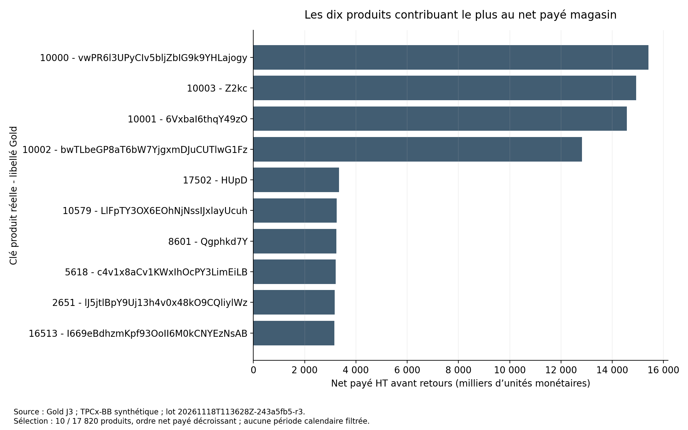
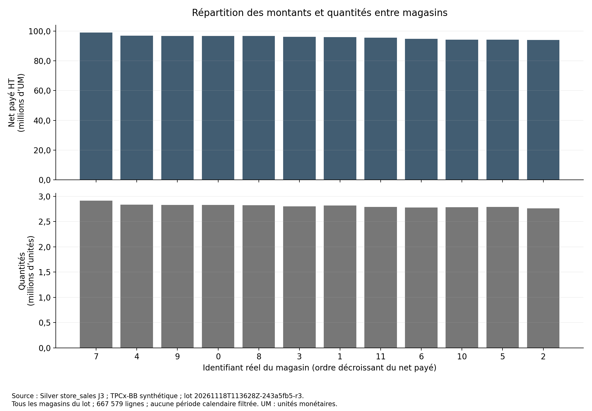
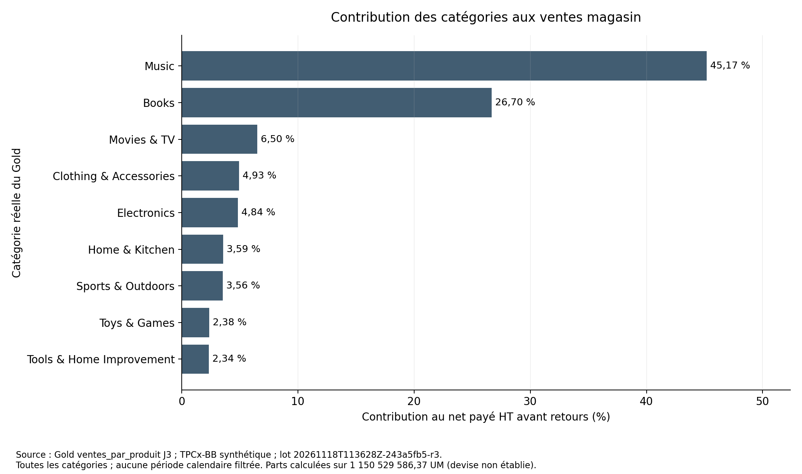
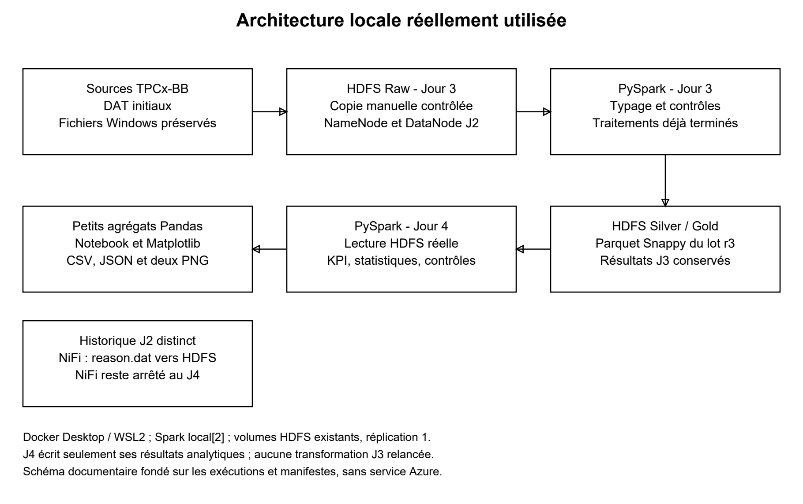
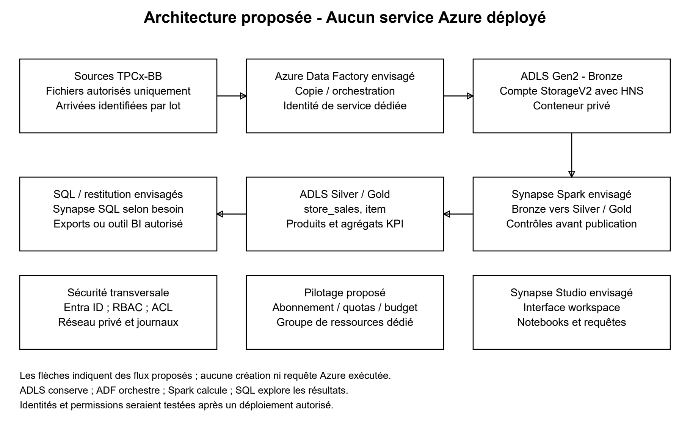
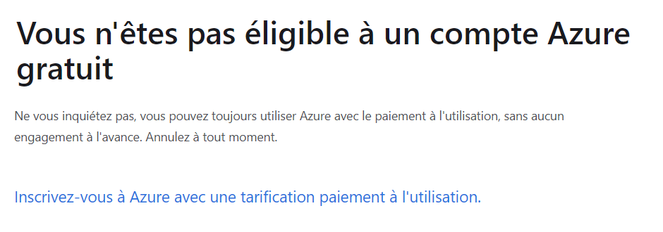

# DAT Retail Intelligence Platform - Jour 4 - Version améliorée V2

UC-08 - Analyse décisionnelle et visualisation ; UC-07 - Transposition Azure, parcours B.

Kevin GREGOIRE - IPSSI - Mastère Développement, Data & IA.

19 novembre 2026.

## Bilan des résultats

Cette étude porte sur toutes les ventes en magasin du fichier initial synthétique fourni pour le projet,
avant prise en compte des retours. Leur net payé hors taxe atteint 1 150 529 586,37 UM
(unité monétaire, devise non établie), pour 33 755 474 unités vendues.
Les 89 100 transactions enregistrées représentent un panier moyen hors taxe de
12 912,79 UM. Une transaction peut comporter plusieurs lignes : les 667 579 lignes détaillées
servent au calcul mais ne sont pas le nombre de paniers.

Music et Books contribuent respectivement à 45,17 % et 26,70 %
du montant, soit 71,86 % ensemble. Ces deux catégories concentrent donc
l'essentiel du net payé observé. Les dix premiers produits représentent, à une échelle plus fine, 6,70 % du total.
Ces contributions mesurent des ventes, sans démontrer la rentabilité des catégories ou des produits.

Les douze magasins ont des contributions proches, entre 8,17 % et 8,60 % du montant total.
Le plus élevé atteint 98,95 millions d'UM contre 94,04 millions pour le moins élevé, soit un écart de 5,22 % du minimum.
Une performance normalisée exigerait surface, trafic, jours d'ouverture et période comparable.
Ces écarts ne suffisent pas à classer l'efficacité commerciale des magasins.

Les résultats sont pédagogiques : les données sont synthétiques, la période commerciale n'est pas normalisée,
et les coûts, la demande future et la disponibilité ne sont pas qualifiés. Avant toute décision sur les stocks,
il faudrait examiner ces éléments sur des données réelles et comparables.
Le taux de retour, la comparaison web/magasin et la marge ne sont pas déduits de données absentes ou non qualifiées.
Le parcours B est adapté : la démonstration locale suffit au socle ; ADLS Gen2 et ses accès restent une proposition documentée.


# Environnement réellement utilisé

Exécution le 19 novembre 2026 (Europe/Paris). Les journaux et le lot portent l'heure UTC.
Windows et Docker Desktop/WSL2 hébergent les deux conteneurs déjà utilisés au Jour 3.
retail-j3-spark exécute Spark local[2], dans la limite existante de 4 Gio et 4 CPU ; aucun port publié.
retail-j2-hdfs-1 héberge un NameNode et un DataNode. NiFi reste arrêté.

| Composant | Valeur constatée |
| --- | --- |
| Python calcul | 3.12.3 |
| Interpréteur | /tmp/retail-j3-venv/bin/python |
| Spark / PySpark | 3.5.7 |
| Java | 17.0.18 |
| Hadoop serveur / client Spark | 3.5.0 / 3.3.4 |
| pandas | 2.2.3 |
| matplotlib | 3.9.4 |
| numpy | 2.5.5 |
| notebook | 7.3.3 |
| jupyterlab | 4.3.8 |
| nbformat | 5.10.4 |
| nbclient | 0.10.4 |
| nbconvert | 7.16.6 |
| ipykernel | 6.31.0 |
| Lecture | HDFS RPC, hdfs://hdfs:9000 |
| Driver / shuffle | 1 536 Mio / 4 partitions |


Le venv /tmp/retail-j3-venv a été conservé. Pandas 2.2.3, Matplotlib 3.9.4 et Notebook 7.3.3 ont été ajoutés ;
Notebook fournit également JupyterLab 4.3.8. Aucun Python ni Java global n'a été remplacé.
Le gel complet est dans preuves/environnement/requirements.lock.txt. Les versions J3 des cinq bibliothèques
PySpark, nbformat, nbclient, nbconvert et ipykernel sont restées identiques.

## Tests fonctionnels

Le notebook est exécuté de haut en bas par nbclient dans ce venv : création Spark, lectures des trois Parquet,
schémas, comptages, qualification des tickets, paniers, agrégations, conversion de 10 produits, 12 magasins et 9 catégories vers Pandas, trois figures Matplotlib
et export PNG. Les figures sont également enregistrées dans les sorties du notebook.
JupyterLab est installé et sa version est contrôlée ; le serveur interactif n'a pas été exposé ni utilisé pour les calculs.

## Difficultés résolues

Les conteneurs étaient arrêtés. Leur redémarrage a conservé les volumes. Le NameNode a quitté automatiquement
le mode sûr ; aucun forçage ni formatage. La copie de travail /tmp/retail-j4 a nécessité d'être attribuée à hadoop,
sans modifier les droits des données J3. Les avertissements NativeCodeLoader et WindowExec sont conservés
dans le journal : les médianes exactes trient dans une partition, acceptable pour ce lot pédagogique.
Une première extraction PDF a rencontré l'encodage Windows ; la lecture UTF-8 a résolu le problème.


# Inventaire analytique

Périmètre : fichiers initiaux synthétiques TPCx-BB traités au Jour 3, lot 20261118T113628Z-243a5fb5-r3 uniquement.
Aucun refresh n'est fusionné. Les sources DAT ne sont ni modifiées ni relues pour transformer les données.
Les volumes et types ci-dessous proviennent de la lecture Spark J4, contrôlée par le manifeste J3 copié en annexe.

| Jeu / zone | Grain | Lignes / usage |
| --- | --- | --- |
| store_sales / Silver | Une ligne de vente, sans clé de ligne validée | 667 579 ; K01, K02, J4-L01, magasins |
| item / Silver | Une clé i_item_sk par produit | 17 820 ; contrôle de couverture et unicité |
| ventes_par_produit / Gold | Un agrégat par ss_item_sk | 17 820 ; classement et contribution produits |


## Provenance et chemins

Racine locale J3 vérifiée : J3_Retail_Intelligence_Transformation, à côté de J4.
J2 est sous J1_Retail_Intelligence_DAT/J2_Retail_Intelligence_Ingestion ; son ancien chemin racine n'est pas sa copie de travail actuelle.
DAT et dictionnaire UC-01 : J1_Retail_Intelligence_DAT/J1_Retail_Intelligence_Architecture/travail/DAT_Retail_Intelligence_J1.md
et annexes/UC01_dictionnaire_KPI.xlsx. Le rapport J2 est sous rapport/DAT_Retail_Intelligence_J2.pdf dans le J2 actuel.
Le rapport J3 et son manifeste restent sous rapport/ et donnees_produites/ dans le J3 racine.
Le Compose J2 et le lanceur configuration/preparer.ps1 de J3 ont été consultés, pas modifiés ni relancés pour transformer.
Les rapports J2 et J3 confirment respectivement le test reason.dat et le traitement complet des ventes/produits.
NiFi n'est pas déclaré comme l'ingestion des faits du Jour 3.

### store_sales

Chemin de lecture réellement exécuté : `hdfs://hdfs:9000/retail-lake/silver/j3/20261118T113628Z-243a5fb5-r3/store_sales`.

Format : Parquet Snappy, deux fichiers part et un marqueur _SUCCESS par jeu selon le manifeste J3.


### item

Chemin de lecture réellement exécuté : `hdfs://hdfs:9000/retail-lake/silver/j3/20261118T113628Z-243a5fb5-r3/item`.

Format : Parquet Snappy, deux fichiers part et un marqueur _SUCCESS par jeu selon le manifeste J3.


### ventes_par_produit

Chemin de lecture réellement exécuté : `hdfs://hdfs:9000/retail-lake/gold/j3/20261118T113628Z-243a5fb5-r3/ventes_par_produit`.

Format : Parquet Snappy, deux fichiers part et un marqueur _SUCCESS par jeu selon le manifeste J3.


## Colonnes exploitées et qualité

store_sales : ss_item_sk, ss_store_sk, ss_quantity, ss_net_paid ; ss_ticket_number pour le diagnostic des répétitions,
ss_net_profit pour la conservation des signes. item : i_item_sk pour l'intégrité référentielle.
Gold : ss_item_sk, i_product_name, i_category, quantity_sold, net_paid, sales_line_count, _run_id.
Les métadonnées de provenance J3 sont conservées ; aucune jointure temporelle ni géographique n'est ajoutée.

Le Jour 3 a contrôlé 73 règles : 64 OK, 8 observations et une anomalie documentée ; aucun échec bloquant.
Le Jour 4 revérifie les mesures retenues, le lot, l'unicité des clés produit, les références et tous les agrégats produit.
4 136 répétitions du couple ticket-produit subsistent ; ce couple ne constitue pas une clé de ligne.
Les 495 971 profits négatifs et 3 954 nets payés nuls sont conservés. Aucun net payé ni quantité négative.
Les nulls facultatifs de démographie/adresse/promotion, de marque et de description sont conservés ; les fins de validité produit
restent toutes nulles. Les trois mesures analytiques et les clés produit/magasin utilisées sont complètes.
17 820 produits sont vendus ; aucun produit Silver sans vente dans ce lot. Un autre lot pourrait en contenir.

Limites : synthétique, devise inconnue, canal magasin uniquement, absence de calendrier qualifié dans les Parquet retenus,
pas de contexte de surface/traffic magasin. Les sommes sont des montants avant retours, sans mesure de profitabilité.
Les données de clients ne sont pas exportées dans les résultats analytiques remis.
Le détail machine des nulls et des fichiers lus est dans qualite.json et inventaire.json.


# Dictionnaire des KPI

Les quatre KPI métier K01 à K04 sont prioritaires ; J4-L01 reste un indicateur technique secondaire.
Leur périmètre commun couvre toutes les lignes Silver store_sales du lot initial J3 final.
Aucun filtre, aucune déduplication, aucune imputation. Les quantités et les lignes sont des entiers ; les montants sont en Decimal.
Les résultats numériques sont générés dans analytics/outputs/kpi.csv. Les clés des contrôles sont dans controles.csv.

## K01 - Net payé HT avant retours

| Attribut | Définition |
| --- | --- |
| Objectif | Mesurer la valeur des ventes magasin selon UC-01 |
| Définition exacte | Somme des nets payés, hors taxe, avant imputation de retours |
| Formule | SUM(ss_net_paid) |
| Source | Silver store_sales ; contre-vérification Gold ventes_par_produit |
| Colonnes / types | ss_net_paid decimal(7,2) ; Gold net_paid decimal(17,2) |
| Filtres | Aucun ; lot final uniquement |
| Granularité | Ligne de vente en entrée ; total du canal magasin en sortie |
| Unité | unités monétaires |
| Résultat calculé | 1 150 529 586,37 |
| Contrôles | Référence J3, Gold, sommes magasin et catégories ; rapprochement exhaustif par produit |
| Limites | Ni devise confirmée, ni chiffre d’affaires comptable, ni rentabilité. |

## K02 - Unités vendues

| Attribut | Définition |
| --- | --- |
| Objectif | Mesurer le volume vendu selon UC-01 |
| Définition exacte | Somme des quantités portées par les lignes de vente |
| Formule | SUM(ss_quantity) |
| Source | Silver store_sales ; contre-vérification Gold ventes_par_produit |
| Colonnes / types | ss_quantity integer ; Gold quantity_sold bigint |
| Filtres | Aucun ; lot final uniquement |
| Granularité | Ligne de vente en entrée ; total du canal magasin en sortie |
| Unité | unités |
| Résultat calculé | 33 755 474 |
| Contrôles | Référence J3, Gold, sommes magasin et catégories ; rapprochement exhaustif par produit |
| Limites | Unités du kit ; pas de conversion entre conditionnements ni nombre de références. |

## K03 - Transactions magasin distinctes

| Attribut | Définition |
| --- | --- |
| Objectif | Mesurer le nombre de paniers enregistrés selon UC-01 |
| Définition exacte | En-têtes distincts magasin, après qualification des associations ticket/magasin/date/client |
| Formule | COUNT(*) après GROUP BY ss_ticket_number qualifié |
| Source | Silver store_sales ; agrégation de toutes les lignes par ticket qualifié |
| Colonnes / types | ss_ticket_number bigint ; ss_store_sk, ss_sold_date_sk et ss_customer_sk pour qualifier la clé |
| Filtres | Aucun ; lot final uniquement |
| Granularité | Transaction magasin en sortie ; lignes conservées en entrée |
| Unité | transactions |
| Résultat calculé | 89 100 |
| Contrôles | Complétude, dépendances ticket vers magasin/date/client, références UC-01 et conservation des totaux des paniers |
| Limites | Valable pour le canal magasin initial fourni ; inclure canal et périmètre de lot avant toute réutilisation. |

## K04 - Panier moyen HT par transaction

| Attribut | Définition |
| --- | --- |
| Objectif | Mesurer la valeur moyenne du panier selon UC-01 |
| Définition exacte | Moyenne des sommes de net payé des transactions complètes du fichier fourni |
| Formule | AVG(transaction_net_paid), avec transaction_net_paid = SUM(ss_net_paid) par ticket qualifié |
| Source | Silver store_sales ; agrégation de toutes les lignes par ticket qualifié |
| Colonnes / types | ss_ticket_number bigint ; ss_net_paid decimal(7,2) ; moyenne Spark Decimal à 16 décimales |
| Filtres | Aucun ; lot final uniquement |
| Granularité | Transaction magasin en sortie ; lignes conservées en entrée |
| Unité | UM par transaction |
| Résultat calculé | 12 912,79 |
| Contrôles | Complétude, dépendances ticket vers magasin/date/client, références UC-01 et conservation des totaux des paniers |
| Limites | Avant retours et hors taxe selon UC-01 ; ne mesure pas la moyenne par ligne ni la rentabilité. |

## J4-L01 - Nombre de lignes de vente

| Attribut | Définition |
| --- | --- |
| Objectif | Qualifier le volume de faits analysé |
| Définition exacte | Comptage de toutes les lignes physiques conservées en Silver |
| Formule | COUNT(*) |
| Source | Silver store_sales ; contre-vérification Gold ventes_par_produit |
| Colonnes / types | Toutes les lignes ; Gold sales_line_count bigint |
| Filtres | Aucun ; lot final uniquement |
| Granularité | Ligne de vente en entrée ; total du canal magasin en sortie |
| Unité | lignes |
| Résultat calculé | 667 579 |
| Contrôles | Référence J3, Gold, sommes magasin et catégories ; rapprochement exhaustif par produit |
| Limites | Indicateur ajouté en J4 ; ne mesure ni ticket, ni commande, ni client. |

## Qualification de K03 et K04

La clé retenue est ss_ticket_number dans le canal magasin et le lot initial étudié. Elle détermine un seul magasin,
une seule date et un seul client renseigné. Les cinq colonnes d'en-tête et de montant n'ont aucune valeur nulle.
Les 89 100 tickets correspondent exactement aux 89 100
en-têtes composites ticket/magasin/date/client : ajouter ces dimensions ne scinde aucun panier.
Aucun ticket négatif, aucune clé date non positive, aucune quantité nulle ou non positive.

82 713 tickets ont plusieurs lignes, avec 1 à 14 lignes par ticket.
Les 4 136 répétitions du couple ticket-produit sont conservées, comme au Jour 3. Aucun dédoublonnage.
La somme des paniers est 1 150 529 586,37 UM, strictement égale à K01 ; les effectifs et quantités se réconcilient aussi.

K04 = 1 150 529 586,37 / 89 100 = 12 912,7899704826038159 UM.
La moyenne est calculée avec Spark sur les paniers agrégés ; le quotient indépendant Decimal la confirme à moins de 0,000000000001 UM.
L'arrondi décimal au centime donne 12 912,79 UM, égal au résultat J1. Le montant moyen par ligne,
1 723,44 UM, est une autre mesure. HT reprend le DAT initial : net hors taxe et après coupons ; les deux identités
net + taxe = TTC et vente - coupon = net présentent zéro écart sur toutes les lignes.

Le SHA-256 source Silver correspond à l'inventaire initial J1 : 7e0a7f16b47483741754bb641c92601dd7384dacc8331d0bcfb8abac82ed3d2e.
Les contrôles J1 de résolution des dates et de complétude des transactions sont conservés en provenance ; leurs associations sont
revérifiées en J4 V2. La complétude porte sur le fichier livré, sans preuve externe d'exhaustivité de caisse ni d'annulations absentes.
Les 89 100 identifiants partagés historiquement entre web et magasin interdisent d'étendre la clé à plusieurs canaux sans le canal.

## Indicateurs non retenus et indicateurs indisponibles

K03 et K04, non retenus dans la version initiale J4, sont désormais qualifiés et calculés en V2.
K12 (taux de retour) reste suspendu : retours non présents dans les Parquet choisis, lien vente-retour et maturité non validés.
K05 (variation mensuelle) exige le calendrier et des mois comparables : une clé date numérique ne suffit pas ici.
K01 par canal comparé au web ne peut pas être produit avec les seules ventes magasin retenues. Une marge commerciale fiable
exigerait une qualification des coûts et du périmètre ; la présence de ss_net_profit ne démontre pas cette qualification.

Les parts produit, magasin et catégorie sont des décompositions de K01 : 100 × montant du groupe / montant global.
Le dénominateur est strictement positif ; les parts sont publiées à 12 décimales et contrôlées avec une tolérance de 0,0000001 point.


# Analyses statistiques

Périmètre exhaustif du même lot, sans échantillonnage. Les statistiques Silver décrivent les lignes, celles de Gold les produits.
Les médianes sont exactes : moyenne Decimal des une/deux valeurs centrales triées avec Spark.
Les sommes et moyennes monétaires restent décimales ; les écarts-types de population sont des flottants, arrondis ici.
Les cellules nulles seraient exclues des statistiques de mesure et leur couverture resterait publiée, sans remplacement par zéro.

| Jeu / mesure | Minimum | Médiane | Moyenne | Maximum | Écart-type |
| --- | --- | --- | --- | --- | --- |
| store_sales / ss_quantity | 1,00 | 51,00 | 50,56 | 100,00 | 28,88 |
| store_sales / ss_net_paid | 0,00 | 878,54 | 1 723,44 | 18 745,00 | 2 167,90 |
| ventes_par_produit / quantity_sold | 230,00 | 1 044,00 | 1 894,25 | 454 954,00 | 9 315,96 |
| ventes_par_produit / net_paid | 2 786,76 | 34 949,04 | 64 563,95 | 15 408 393,55 | 317 929,78 |
| ventes_par_produit / sales_line_count | 6,00 | 21,00 | 37,46 | 9 029,00 | 184,43 |

Les cinq mesures ont une couverture de 100 %. Les sommes sont exportées avec les effectifs dans statistiques.csv.
Le référentiel et Gold ont chacun 17 820 clés distinctes ; 12 identifiants magasin sont observés.
Le net payé par ligne a une moyenne de 1 723,44 UM, près du double de la médiane 878,54 UM : les montants sont dispersés.
La médiane Gold de 34 949,04 UM et son maximum de 15 408 393,55 UM montrent une forte hétérogénéité entre produits.
Ces constats ne suffisent pas à qualifier des anomalies de saisie dans un jeu synthétique.
3 954 lignes ont un net payé nul ; aucune n'est exclue. Les valeurs net payé et quantité ne sont pas négatives ; les profits négatifs restent conservés.
La répartition complète par magasin est publiée dans ventes_par_magasin.csv ; celle par produit dans contributions_produits.csv.

La V2 ajoute la distribution du nombre de lignes par ticket dans repartition_lignes_par_ticket.csv : 89 100 tickets, dont 82 713 multilignes, de 1 à 14 lignes. Le panier moyen est 12 912,79 UM ; il ne remplace pas la moyenne par ligne. La répartition des neuf catégories est dans ventes_par_categorie.csv.


# Analyses métier : produits, magasins et catégories

## Analyse 1 - Contribution des produits au net payé

Question : quels produits contribuent le plus au net payé magasin ? Le besoin précise Q03 (produits par canal)
et Q05 (net payé) du DAT J1. Source : Gold ventes_par_produit, un seul lot et une seule ligne par ss_item_sk.
Méthode : tri décroissant de net_paid, départage par clé produit, sélection explicite des dix premières lignes.
La contribution rapporte chaque montant au total global K01. Les libellés sont ceux du kit, sans correction inventée.

| Clé produit | Net payé (UM) | Contribution (%) |
| --- | --- | --- |
| 10000 | 15 408 393,55 | 1,3392 |
| 10003 | 14 933 870,10 | 1,2980 |
| 10001 | 14 572 124,66 | 1,2666 |
| 10002 | 12 817 437,86 | 1,1140 |
| 17502 | 3 336 529,83 | 0,2900 |
| 10579 | 3 250 367,57 | 0,2825 |
| 8601 | 3 238 749,92 | 0,2815 |
| 5618 | 3 212 955,42 | 0,2793 |
| 2651 | 3 172 287,79 | 0,2757 |
| 16513 | 3 162 636,37 | 0,2749 |


Résultat : le produit 10000 contribue 15 408 393,55 UM, soit 1,3392 %.
Les dix premiers représentent 6,7017 % ; les cent premiers 28,1203 %.
Dix références ne représentent que 0,0561 % des produits : leur poids dans les ventes est disproportionné,
mais elles ne représentent pas la majorité du net payé. Le reste des produits porte 93,2983 %.

Contrôle : le montant total Gold et les 17 820 lignes produit se réconcilient avec une nouvelle agrégation Silver,
sans différence sur montant, quantité et nombre de lignes. La somme des contributions arrondies atteint
100,000000000863 %, conforme à la tolérance numérique documentée.

Interprétation : certaines références concentrent beaucoup plus de montant que la référence médiane.
Recommandation pédagogique : examiner leur disponibilité et leur contexte avant une décision d'assortiment.
Limites : données synthétiques, agrégats de tout le lot, absence de coûts qualifiés et de période commerciale normalisée.
Une forte contribution n'est pas une forte rentabilité. Le premier graphique utilise des barres horizontales et un axe à zéro.

## Analyse 2 - Répartition des montants et quantités par magasin

Question : comment les montants et quantités se répartissent-ils entre magasins ? Cette déclinaison précise Q05
et le besoin du responsable magasin Q07, sans prétendre répondre à toute l'analyse des familles de produits.
Source : Silver store_sales ; regroupement Spark par ss_store_sk. Aucune dimension store non qualifiée n'est jointe.

| Magasin | Net payé (UM) | Unités | Lignes | Part (%) |
| --- | --- | --- | --- | --- |
| 7 | 98 950 137,76 | 2 915 053 | 57 589 | 8,60 |
| 4 | 96 770 105,59 | 2 832 572 | 56 211 | 8,41 |
| 9 | 96 748 356,68 | 2 830 684 | 56 040 | 8,41 |
| 0 | 96 727 851,94 | 2 830 581 | 56 018 | 8,41 |
| 8 | 96 578 622,89 | 2 821 869 | 55 737 | 8,39 |
| 3 | 96 063 990,59 | 2 800 824 | 55 397 | 8,35 |
| 1 | 95 929 844,66 | 2 817 524 | 55 676 | 8,34 |
| 11 | 95 607 843,48 | 2 790 631 | 55 473 | 8,31 |
| 6 | 94 751 173,08 | 2 780 253 | 54 574 | 8,24 |
| 10 | 94 263 977,55 | 2 785 773 | 55 109 | 8,19 |
| 5 | 94 097 279,37 | 2 789 703 | 55 122 | 8,18 |
| 2 | 94 040 402,78 | 2 760 007 | 54 633 | 8,17 |


Résultat : le magasin 7 atteint 98 950 137,76 UM et 2 915 053 unités ; le magasin 2 atteint 94 040 402,78 UM
et 2 760 007 unités. L'écart est de 4 909 734,98 UM, soit 5,22 % du minimum.
Les parts monétaires restent proches, entre 8,17 % et 8,60 %, autour de 8,33 % pour une répartition uniforme.

Contrôle : sommes des douze magasins strictement égales aux trois totaux Silver, y compris au centime pour K01.
Le graphique à deux panneaux compare montant et quantité dans des unités séparées ; il couvre tous les magasins.
Les écarts de volume suivent globalement ceux des montants, sans démontrer une relation causale.
Recommandation : obtenir surface, fréquentation, durée d'ouverture et période fiable avant un jugement de performance.
Les noms commerciaux sont absents du périmètre qualifié ; seuls les identifiants sont affichés.

## Analyse 3 - Contribution des catégories au montant des ventes

Question : quelles catégories contribuent le plus au montant et au volume des ventes magasin ? Cette lecture
précise le besoin Q03 sur l'assortiment et Q07 sur les familles, sur le périmètre global magasin.
Source : Gold ventes_par_produit validé J3, regroupé directement par i_category, sans nouvelle jointure ni réécriture du Gold.
Méthode : sommes de net_paid, quantity_sold et sales_line_count, compte des produits et part du net payé global.

| Catégorie | Net payé (UM) | Unités | Lignes | Part (%) |
| --- | --- | --- | --- | --- |
| Music | 519 666 693,84 | 15 238 374 | 301 236 | 45,1676 |
| Books | 307 151 503,25 | 9 007 511 | 177 671 | 26,6965 |
| Movies & TV | 74 735 891,89 | 2 189 279 | 43 376 | 6,4958 |
| Clothing & Accessories | 56 754 855,82 | 1 640 550 | 32 372 | 4,9329 |
| Electronics | 55 715 087,49 | 1 632 098 | 32 619 | 4,8426 |
| Home & Kitchen | 41 260 511,11 | 1 226 839 | 24 380 | 3,5862 |
| Sports & Outdoors | 40 926 938,33 | 1 209 305 | 23 911 | 3,5572 |
| Toys & Games | 27 437 825,33 | 809 999 | 16 121 | 2,3848 |
| Tools & Home Improvement | 26 880 279,31 | 801 519 | 15 893 | 2,3363 |


Les 9 catégories couvrent tous les 17 820 produits et aucune catégorie n'est nulle ou vide.
Music apporte 45,1676 % du net payé ; Books 26,6965 %.
Ensemble, elles totalisent 826 818 197,09 UM, soit 71,8641 %.
Cette concentration décrit la contribution monétaire ; les quantités constituent une autre mesure, publiée dans le tableau.
Les libellés réels restent inchangés. Toute catégorie manquante aurait été conservée comme groupe explicite et signalée.

Contrôles : montants, quantités et lignes par catégorie sont strictement égaux à K01, K02 et J4-L01 ;
les parts se réconcilient avec 100 % à la tolérance documentée. Le tableau complet sert au troisième graphique.
La précision des divisions Decimal est préservée avant affichage ; le tracé utilise seulement neuf agrégats Pandas.

Interprétation : Music et Books concentrent une grande part du montant de ce jeu synthétique. Cela ne démontre ni
rentabilité supérieure ni demande future. Recommandation pédagogique conditionnelle : examiner demande, marges,
disponibilité et période comparable avant toute décision sur l'assortiment ou les stocks ; aucun ajustement direct n'est proposé.


# Visualisation 1 - Contribution produit



Les dix premiers produits portent 6,70 % du net payé ; le premier représente 1,3392 %. Le graphique sélectionne les plus forts montants, pas les marges. Source : top10_produits.csv ; périmètre synthétique initial complet. Les libellés longs sont raccourcis à 32 caractères ; la clé réelle et le CSV complet lèvent l’ambiguïté.

# Visualisation 2 - Comparaison des magasins



Les douze magasins sont couverts. Le magasin 7 est le plus élevé en montant et en quantité, sans conclusion de meilleure efficacité commerciale. Les deux panneaux séparent les unités ; aucune date commerciale ni enseigne fictive n’est ajoutée. Source : ventes_par_magasin.csv.

# Visualisation 3 - Contribution des catégories



Music et Books représentent ensemble 71,86 % du net payé. Les neuf catégories sont couvertes sans valeur manquante. Les parts décrivent une contribution monétaire, sans conclusion sur les marges ni décision directe sur les stocks. Source : ventes_par_categorie.csv, Gold J3 initial synthétique complet.

# Contrôles et réconciliations

45 contrôles analytiques sont OK, dont les 26 contrôles initiaux réexécutés. Silver, Gold, références J3, paniers, catégories et douze magasins concordent sur 667 579 lignes, 33 755 474 unités et 1 150 529 586,37 UM. Aucun produit non rapproché ni différence sur les 17 820 agrégats produit. Les parts arrondies sont cohérentes à 0,0000001 point près.

La qualification de K03/K04 vérifie la complétude, les associations ticket/magasin/date/client, la concordance avec les en-têtes composites, les 82 713 tickets multilignes, les sommes des paniers et la moyenne Decimal. Le montant moyen HT de 12 912,79 UM au centime concorde avec UC-01 ; il ne remplace pas le montant moyen par ligne.

Les colonnes mesurées sont complètes et les deux clés produit uniques. Les valeurs des trois figures sont comparées à leurs tableaux. Le notebook est exécuté de bout en bout sans erreur sauvegardée. Voir preuves/analyses/validation.json, qualification_transactions.json et controles.csv.

Les nulls facultatifs, les 4 136 répétitions ticket-produit et les profits négatifs sont conservés. Les travaux antérieurs sont protégés par empreintes avant/après et listings HDFS ; la sauvegarde initiale et les changements V2 sont consignés dans verification/correction_v2.

# Architecture Azure proposée

Architecture proposée - Aucun service Azure déployé.

Le parcours B est définitif. La capture utilisateur du 19 novembre 2026 montre l'inéligibilité à l'offre gratuite
et propose uniquement le paiement à l'utilisation. Aucun abonnement payant, carte bancaire, compte de contournement
ou ressource Azure n'a été créé. Aucun coût Azure réel n'a été engagé par les travaux J4.
Le socle TP4 §9.2 autorise cette étude et la démonstration locale sans installer l'ensemble du Lakehouse.

## Ressources et responsabilités

Un abonnement porterait la facturation et les quotas. Le groupe de ressources rg-retail-j4-etude rassemblerait
le stockage et les éventuels services associés. Un compte StorageV2, nommé ici stretailj4demo2026 à titre indicatif,
contiendrait le conteneur privé retail-intelligence. Ce nom n'a pas été réservé ni sa disponibilité vérifiée.
ADLS Gen2 désigne les capacités Data Lake de Blob Storage obtenues avec HNS, pas un second disque à créer [A1].
Les arborescences Bronze/Silver/Gold assureraient la continuité avec les zones HDFS déjà employées.

Azure Data Factory serait envisagé pour copier et orchestrer les arrivées des fichiers. Pour une source Windows
privée, il faudrait prévoir une connectivité autorisée ou un runtime d'intégration adapté. Les sources synthétiques
et les données complémentaires éventuelles seraient distinguées. Aucune donnée complémentaire n'est utilisée ici [A5].

Synapse Analytics proposerait un workspace analytique. Synapse Studio servirait d'interface aux notebooks,
pipelines et requêtes. Un Spark Pool définirait le calcul managé ; les transformations PySpark utiliseraient
des chemins abfss et une identité autorisée au lieu de l'adresse HDFS locale. Les capacités SQL serverless
permettraient d'explorer des fichiers ; un pool SQL dédié réserverait des ressources et répondrait à un autre
besoin de charge. Les formats compatibles et autorisations devraient être vérifiés avant leur utilisation [A6, A7].

Les choix restent hypothétiques : aucune version du runtime Synapse n'est présumée identique à Spark 3.5.7.
Il faudrait tester les bibliothèques et les résultats après migration. ADF ne remplace pas le stockage ;
Spark calcule ; ADLS conserve les données. Les exports CSV et notebooks pourraient restituer les petits résultats.

## Architecture locale démontrée

Les sources du kit ont été copiées en Raw HDFS au J3, puis transformées par PySpark en Parquet Silver/Gold.
J4 relit ces trois jeux par HDFS RPC et produit des agrégats dans son espace distinct. Matplotlib et le notebook
restituent ces résultats. Le stockage est dans les volumes Docker existants ; Spark local[2] s'exécute dans WSL2.
NiFi apparaît uniquement dans l'historique J2 GetFile vers PutHDFS de reason.dat. Il n'a pas ingéré les faits J3.
Ni Azure, ni MinIO, Iceberg, Trino, Airflow ou Superset ne sont déployés dans cette réalisation.


# Schémas d’architecture



La partie historique J2 est séparée des traitements J3 et de l’analyse J4.



Les flèches de la cible Azure représentent des flux envisagés. Les SVG et le script de dessin sont modifiables ; ce sont des schémas, pas des captures de portail.

# Organisation ADLS Gen2 et HNS

Proposition uniquement. Conteneur privé : retail-intelligence, compte StorageV2 avec HNS activé.
Exemple d'URI : abfss://retail-intelligence@stretailj4demo2026.dfs.core.windows.net/silver/store_sales/lot=20261118T113628Z-243a5fb5-r3/
Il ne s'agit ni d'un chemin créé ni d'une nouvelle arborescence HDFS.

```text
retail-intelligence/
  bronze/tpcxbb/initial/lot=<lot>/store_sales.dat et item.dat
  silver/store_sales/lot=<lot>/part-*.snappy.parquet
  silver/item/lot=<lot>/part-*.snappy.parquet
  gold/ventes_par_produit/lot=<lot>/part-*.snappy.parquet
  gold/analytics/lot=<lot>/kpi.csv et ventes_par_magasin.csv
  quality/lot=<lot>/controles.json et manifest.json
  documentation/j4/rapport.pdf et dictionnaire_kpi.md
```

| Zone | Données / grain / origine | Conservation proposée | Accès proposés |
| --- | --- | --- | --- |
| Bronze | DAT originaux J3, lignes brutes ; initial séparé du refresh | Pendant le projet puis 90 jours, à valider | Ingestion écrit son dépôt ; ingénieur lit |
| Silver | Parquet Snappy J3 : ligne vente et clé produit | Lot validé et précédent pendant le projet | Ingénieur lit/écrit ; analyste conditionnel |
| Gold | Parquet J3 produit ; CSV agrégés J4 | Lot validé pendant le projet et 90 jours | Ingénieur publie ; analyste/restitution lisent |
| Quality | CSV/JSON, règle de contrôle et manifeste par lot | Un an proposé, sans contenu personnel superflu | Services écrivent leurs traces ; ingénieur contrôle |
| Documentation | MD/PDF/PNG, version de document | Durée du projet et un an proposé | Ingénieur publie ; profils habilités lisent |


Les durées sont des choix pédagogiques à faire approuver par le responsable du futur environnement ; aucune suppression automatique
n'est activée. Toute purge devrait respecter les besoins de preuve et les règles de conservation applicables.
Noms en minuscules ASCII, séparateur underscore pour les tables, lot UTC avec suffixe unique ; le nom original des part Parquet
serait conservé lors d'une copie. Un manifeste relierait source, SHA-256, lot, schéma, compteurs et version de script.
Aucune date commerciale n'est inventée pour partitionner les données ; lot identifie une exécution, pas un jour de vente.

## Hierarchical Namespace

HNS organise de vrais répertoires et permet leur renommage par opération de métadonnées, utile aux publications de traitements.
Un stockage objet plat utilise des préfixes ressemblant à des dossiers, avec d'autres coûts d'opérations.
L'activation HNS ne peut pas être annulée ; les fonctionnalités compatibles doivent être vérifiées avant création ou mise à niveau [A2].
Les accès fins portent sur les chemins : la traversée des ancêtres requiert x ; une lecture/listage de répertoire nécessite r-x [A4].
Le chiffrement au repos relève des capacités Storage, pas d'un effet de la seule convention Bronze/Silver/Gold [A1].
Le driver ABFS et les endpoints dfs sont prévus ; les contraintes réseau doivent couvrir dfs et blob lorsqu'on utilise des endpoints privés [A8].


# Sécurité et matrice des permissions

Matrice cible seulement, non appliquée à Azure. L = lecture, E = écriture, A = administration temporaire,
C = accès conditionnel et limité à un sous-répertoire/une mission, - = aucun accès.
L'accès du conteneur n'est pas public. Les permissions ci-dessous ne constituent pas une preuve de test Azure.

| Profil | Bronze | Silver | Gold | Quality | Documentation |
| --- | --- | --- | --- | --- | --- |
| Administrateur | A/C | A/C | A/C | A/C | A/C |
| Service ingestion | E/C | - | - | E/C | L/C |
| Data Engineer | L | L/E | L/E | L/E | L/E |
| Analyste métier | - | L/C | L | L/C | L |
| Service restitution | - | - | L/C | - | L/C |

## Traduction technique proposée

L'administrateur gérerait le plan de contrôle via un rôle adapté ; l'administration des données demanderait
une habilitation Storage Blob Data Owner temporaire et auditée. Aucun droit de lecture métier permanent n'est justifié par le seul rôle administratif.
Les profils ordinaires utiliseraient des groupes Entra ou identités managées, et des ACL limitées aux chemins nécessaires.
Un rôle Data Contributor attribué au conteneur entier donnerait trop de droits : une ACL ne peut pas retirer un accès déjà accordé par RBAC [A3].

Pour le service ingestion, C signifie un sous-répertoire d'arrivée neuf et ses propres traces. wx permet de créer des enfants ;
cette permission peut aussi permettre leur suppression. Elle n'est donc pas une garantie append-only. La publication finale devrait
être réalisée par un autre rôle, puis le dépôt rendu non modifiable par l'ingestion. L'analyste peut lire Silver uniquement après
autorisation d'un sous-ensemble utile et minimisé. La restitution lit uniquement les agrégats Gold approuvés.

Les fichiers Gold seraient r-- pour l'analyste, leurs répertoires r-x et les ancêtres --x. Pour l'ingénieur, rw- sur fichiers
et rwx sur les zones de sortie nécessaires, avec masque ACL cohérent. Les ACL par défaut préparent les droits des futurs enfants ;
elles ne corrigent pas rétroactivement les enfants existants. Des tests négatifs doivent contrôler les accès interdits [A4].

## Identité, réseau et secrets

Microsoft Entra ID authentifierait utilisateurs, groupes et applications. Les identités de service seraient distinctes
pour ingestion, calcul et restitution. Privilégier les identités managées, éviter les clés dans scripts/notebooks et utiliser
un coffre de secrets autorisé si un secret est nécessaire. Les accès anonymes et les clés partagées banalisées compromettraient
la séparation prévue. Les rôles de gestion ne doivent pas être confondus avec les rôles d'accès aux données [A3].

Proposition : réseau privé, pare-feu limitant les sources, chiffrement du transport et journalisation des accès refusés.
Les endpoints privés dfs ET blob et la résolution DNS doivent être testés ensemble [A8].
Même avec des données synthétiques, minimiser les attributs client dans les exports et masquer les identifiants personnels
des captures. Avec des données réelles, classification, droits d'accès, rétention et diffusion demanderaient une revue spécifique.

## Mécanismes locaux réellement observés

HDFS utilise hadoop.security.authentication=simple et dfs.permissions.enabled=true. Le répertoire Gold est détenu
par hadoop:supergroup, avec droits rwxr-xr-x ; les fichiers Parquet sont rw-r--r--. Il n'y a pas de Kerberos démontré.
Le calcul s'exécute comme hadoop ; tous les profils de la matrice ne sont donc pas isolés par des identités locales distinctes.
Le RPC reste sur le réseau Docker, le port web NameNode sur 127.0.0.1:9870 ; Spark ne publie aucun port.
Le montage des sources dans Spark est en lecture seule ; le montage /work de J3 est techniquement accessible en écriture,
mais aucun script J4 ne lui écrit et ses fichiers sont comparés par empreintes avant/après.
Cette protection de lab n'est pas l'équivalent d'Entra/RBAC ; aucun test d'intrusion ni validation de sécurité de production n'est revendiqué.


# Correspondance fonctionnelle Azure / open source

Les noms ne constituent pas des équivalences complètes. Tous les services Azure restent étudiés.

| Fonction | Azure proposé | Composant du parcours B / état | Limite de correspondance |
| --- | --- | --- | --- |
| Stockage Data Lake | ADLS Gen2 avec HNS | HDFS réel J2/J3, relu en J4 | HDFS mono-nœud n'est ni stockage objet managé ni service hautement disponible. MinIO serait un stockage S3 étudié, non installé. |
| Transformation | Synapse Spark | PySpark 3.5.7 réellement utilisé | Même famille de moteur, mais exploitation, réseau et runtimes diffèrent. |
| Requêtes SQL | Synapse SQL serverless ou dédié selon besoin | Spark SQL utilisé pour les médianes ; Trino étudié | Spark SQL ne reproduit pas tout le service SQL managé ; Trino serait un moteur supplémentaire. |
| Orchestration / intégration | ADF envisagé | Scripts et nbclient J4 ; NiFi réel J2, arrêté J4 | Les scripts ne fournissent pas toute la supervision ADF ; Airflow pourrait planifier, sans transformer lui-même. |
| Tables analytiques | Fichiers/tables adaptés aux moteurs Azure | Parquet Snappy réel | Parquet seul n'assure pas des transactions ACID. Iceberg serait un format de table avec métadonnées, pas un moteur ni Synapse. |
| Catalogue | Métadonnées des services Azure | Schémas Parquet et manifestes JSON réels | Pas de catalogue partagé installé. Nessie ou Hive Metastore seraient étudiés seulement si des tables Iceberg devaient être ajoutées. |
| Visualisation | Power BI éventuel | Jupyter et Matplotlib réels | Images et notebook n'offrent pas une plateforme BI de diffusion. Aucun tableau de bord ajouté. |
| Identités / accès | Entra, RBAC, ACL | Compte hadoop, permissions HDFS et isolation Docker constatés | Authentification simple et permissions larges de lab ; pas d'équivalence avec l'identité fédérée Azure. |
| Exécution | Services managés | Docker Desktop/WSL2 existant | Administration, sauvegarde et disponibilité restent locales. |

Synapse regroupe plusieurs fonctions ; les reproduire demanderait stockage, Spark, moteur SQL, catalogue et orchestration.
Le socle TP4 autorise de s'arrêter à la démonstration locale et à cette comparaison argumentée.
MinIO, Iceberg, Trino, Nessie, Hive Metastore supplémentaire, Airflow, Superset, Delta Lake et Hudi n'ont pas été installés.


# Simulation documentaire Azure - non exécutée

Toutes les étapes ci-dessous sont un scénario conditionnel pour un futur environnement autorisé.
Aucun appel Azure, aucune ressource, aucune facture ni pipeline ne résulte de ce dossier.

| Étape proposée | Ressource / action non exécutée | Contrôle à réaliser après autorisation |
| --- | --- | --- |
| 1. Cadrer | Abonnement autorisé, région proche des usages, quotas, groupe rg-retail-j4-etude | Vérifier habilitations, conformité de la région et plafond d'exposition financière. |
| 2. Préparer le stockage | Compte StorageV2 stretailj4demo2026 indicatif, HNS activé, conteneur privé retail-intelligence | Contrôler disponibilité du nom, HNS, accès anonyme désactivé et capacités compatibles. |
| 3. Préparer les chemins | Zones et lots décrits dans organisation.md | Lister zones, vérifier conventions et absence de collision de lots. |
| 4. Préparer les identités | Groupes Entra ; identités managées ingestion, calcul, restitution ; ACL et portées RBAC | Tester lecture, écriture et refus avec chaque identité ; vérifier ancêtres et masque. |
| 5. Déposer une preuve | Dépôt du seul kpi.csv agrégé J4, via Storage Explorer ou AzCopy avec identité Entra | Taille, SHA-256 après téléchargement, en-tête, lignes, présence et lecture ; ne pas confondre ETag et SHA-256. |
| 6. Déplacer les données du projet | Après accord, copies J3 Parquet vers Silver/Gold, DAT autorisés en Bronze ; ADF facultatif | Manifeste fichier par fichier et identifiant 20261118T113628Z-243a5fb5-r3 ; ne pas agréger plusieurs lots. |
| 7. Transformer si nécessaire | Notebook PySpark adapté aux URI abfss, Spark Pool Synapse facultatif | Tester types Decimal, dépendances, nombre de lignes et concordance des montants avec les références locales. |
| 8. Explorer / restituer | Synapse Studio ; requêtes SQL sur Gold ou exports agrégés | Vérifier types, grain, permissions et résultats ; confirmer le format supporté par le mode SQL choisi. |
| 9. Exploiter | Suivi des erreurs, journaux, budgets et alertes ; pause/arrêt du calcul selon le service | Vérifier consommation, ressources persistantes et restauration. Un budget est une alerte, pas une garantie d'arrêt de la facture. |

La première preuve de dépôt serait volontairement minime : kpi.csv ne contient que des agrégats et aucune donnée client.
Un lot complet demanderait un manifeste associant chaque fichier, sa provenance, son schéma et ses empreintes.
On conserverait les trois mesures : 667 579 lignes, 33 755 474 unités, 1 150 529 586,37 UM.
Ces valeurs sont des critères attendus pour le même périmètre, pas une preuve d'exécution Azure.

## Limites de la simulation

Noms, région, rétention et habilitations sont proposés. Aucune disponibilité de ressource, de quota, de réseau ni de rôle n'est validée.
Une matrice documentaire ne prouve pas l'efficacité des accès. Aucune comparaison de performance ou de coût observé Azure/local n'est possible.
Le document n'est pas un script de déploiement et ne doit pas être présenté comme un export du portail.


# Coûts, quotas et risques - étude uniquement

Aucun coût Azure réel n'a été engagé par le Jour 4. Aucun tarif chiffré actuel n'est inventé.
Le calculateur officiel a été consulté, sans établir de devis ni créer d'abonnement [A9].

| Poste | Unités à estimer | Paramètres / prévention proposés |
| --- | --- | --- |
| Stockage et opérations | Gio-mois, lectures/écritures/listages | Volume de toutes les copies, classe d'accès, redondance et rétention ; éviter les doublons inutiles. |
| Spark | Durée du calcul et ressources instanciées | Taille/nombre de nœuds, démarrage, relances, cache et durée de session ; auto-pause selon disponibilité. |
| Pipelines | Exécutions, activités, déplacement | Fréquence, runtime d'intégration, reprises et volume transféré. |
| SQL | Données traitées en serverless ou capacité dédiée | Projection/filtrage, fréquence des requêtes ; aucun pool dédié nécessaire pour cette étude. |
| Transferts et réseau | Gio sortants, régions, endpoints | Colocaliser les ressources et vérifier les règles tarifaires exactes. |
| Journaux | Volume ingéré, rétention | Conserver les preuves utiles, minimiser les attributs sensibles et fixer une rétention. |
| Persistance | Stockage, disques, réseau ou calcul non arrêté | Inventaire de fin de session ; la fermeture d'un navigateur n'arrête pas un calcul. |

Méthode : établir la volumétrie, le nombre de sessions/requêtes et la durée ; choisir région, monnaie, offres et redondance ;
saisir ces hypothèses dans le calculateur ; enregistrer la date et le devis puis appliquer une marge pour reprises et journaux.
Vérifier quotas de calcul, limites de débit et capacité avant tout essai. Une définition de Spark Pool seule n'instancie pas
nécessairement le calcul : les travaux Spark déclenchent les instances consommées [A7]. Les budgets et alertes complètent la surveillance.
Les principaux risques sont les sessions actives, scans SQL répétés, sorties de données, droits trop larges et secrets diffusés.
Rien de ces garde-fous n'est présenté comme configuré sur Azure dans ce parcours B.


# Justification du parcours B



J4-P09 : capture utilisateur du 19 novembre 2026. Le message et l’option de paiement restent dans leurs pixels d’origine ; le recadrage exclut adresse et session. Aucun abonnement payant n’a été créé. Le TP4 prévoit le parcours B ; l’absence de crédits n’empêche pas ce socle. La provenance et l’empreinte de l’original sont consignées séparément.

# Les quatorze questions de recul du TP4, section 15

Formulations du document pédagogique, avec typographie normalisée.

## 1. Pourquoi faut-il vérifier la granularité avant de calculer un KPI ?

Une ligne Silver représente une vente détaillée ; une ligne Gold représente un produit. COUNT(*) donne donc 667 579 faits ou 17 820 produits. La bonne somme dépend de ce grain ; Gold doit sommer sales_line_count pour retrouver les faits.

## 2. Quelle différence existe entre un nombre de lignes et un nombre de transactions ?

Un ticket peut regrouper plusieurs lignes. Les 667 579 lignes ne sont pas 667 579 transactions. Le canal et les dimensions identifiant un en-tête doivent être vérifiés avant un compte distinct ou un panier moyen ; le couple ticket-produit se répète 4 136 fois.

## 3. Quelles limites avez-vous rencontrées dans les données utilisées pour vos analyses ?

Le lot est synthétique, la devise n’est pas établie et le périmètre ne contient que les ventes magasin. Des attributs facultatifs sont nuls, les noms magasins et un calendrier qualifié ne sont pas utilisés. Les différences ne sont pas normalisées par taille ou fréquentation.

## 4. Quels indicateurs n’avez-vous pas pu calculer, et pour quelles raisons ?

K12 reste suspendu : les retours ne sont pas dans ces Parquet et leur rattachement n’est pas validé. La variation mensuelle nécessite un calendrier qualifié et la comparaison par canal le web. K03 et K04 sont désormais validés en V2 après qualification des tickets ; la marge n’est pas défendue sans coûts qualifiés.

## 5. Comment avez-vous vérifié la cohérence des résultats ?

Les trois totaux Silver correspondent aux références J3, aux sommes Gold, aux douze magasins et aux neuf catégories. Une nouvelle agrégation Silver rapproche les 17 820 produits sans écart. Les 45 contrôles incluent la qualification des tickets, les paniers, références, lot, nulls et parts. Les PNG sont reliés aux tableaux numériques puis inspectés visuellement.

## 6. Quelle différence existe entre un constat statistique et une conclusion causale ?

Le magasin 7 présente plus de net payé que le 2 : c’est un constat. L’attribuer à une meilleure équipe serait causal et non démontré. Il faudrait contrôler période, clientèle, taille, assortiment et autres facteurs, puis une méthode capable de distinguer ces explications.

## 7. Pourquoi les données synthétiques doivent-elles être identifiées dans la restitution ?

Elles servent à apprendre à traiter et vérifier les données. La concentration des produits du générateur ne décrit pas nécessairement une enseigne réelle. Le signaler empêche d’utiliser ces montants comme une observation commerciale ou une prévision.

## 8. Quel est le rôle d’ADLS Gen2 dans votre architecture ?

Il serait le stockage durable des zones et des fichiers, avec les capacités Data Lake de Blob Storage. Il remplacerait fonctionnellement le stockage HDFS pour les moteurs autorisés, sans faire lui-même les calculs Spark [A1].

## 9. Quel intérêt apporte le Hierarchical Namespace ?

Il fournit des répertoires réels et des opérations de métadonnées adaptées aux traitements. Le renommage de répertoires facilite la publication d’une sortie. Son activation est irréversible et demande une vérification des fonctionnalités compatibles [A2].

## 10. Quelle différence existe entre RBAC et ACL ?

RBAC attribue des rôles sur une portée de ressources ; les ACL portent sur les chemins et utilisent r/w/x. Une ACL ne peut pas retirer l’accès accordé par un rôle de données trop large. Les groupes et les ancêtres doivent être correctement configurés [A3, A4].

## 11. Dans quels cas Azure Data Factory serait-il utile ?

Pour planifier les dépôts, copier plusieurs sources, enchaîner le contrôle puis le calcul et suivre les erreurs. Les scripts suffisent au lot pédagogique actuel ; ADF resterait à envisager pour des arrivées récurrentes avec connectivité et droits maîtrisés [A5].

## 12. Quel rôle pourrait jouer Synapse Analytics ?

Un workspace et Synapse Studio centraliseraient l’analyse ; Spark traiterait les fichiers ADLS et SQL offrirait des interrogations adaptées. Ce service intégré ne se réduit ni à Iceberg, ni à un répertoire Parquet. Son runtime et ses coûts devraient être qualifiés [A6, A7].

## 13. Quels éléments de votre architecture sont réellement déployés et lesquels restent théoriques ?

HDFS, Docker/WSL2, PySpark et Parquet J3 sont réutilisés ; J4 exécute notebook, Pandas et Matplotlib. NiFi appartient au test J2 et reste arrêté. Azure, les ACL cibles, ADF, Synapse et les composants Lakehouse facultatifs restent proposés ou étudiés.

## 14. Quels seraient les principaux risques de coût ou de sécurité dans une mise en production ?

Calcul laissé actif, scans et transferts répétés, rétention de copies et journaux peuvent générer des dépenses. Les droits excessifs, clés exposées, endpoints publics et données personnelles exportées élargiraient l’exposition. Il faudrait chiffrer les hypothèses, tester les refus et contrôler l’exploitation [A3, A8, A9].


# Preuves, livrables et reproductibilité

Le registre preuves/registre_preuves.md identifie les exécutions, contrôles, études et simulations. verification/suivi_exigences.md reprend les onze libellés exacts du TP4 §13.1. J4-10 s’intitule « Preuves Azure » dans le TP et est satisfait par la simulation documentaire autorisée.

La remise V2 inclut le notebook exécuté, son HTML, les scripts, résultats agrégés, trois graphiques, deux architectures, dictionnaires, études et contrôles. Les données brutes et volumes Docker sont exclus ; le recalcul utilise le lot J3 indiqué. Le README précise les chemins paramétrables, démarrage, exécution et arrêt sans destruction. L’archive est vérifiée par CRC et SHA-256 ; un manifeste permet de vérifier les fichiers remis. La remise initiale reste sauvegardée séparément.

## Conclusion

La V2 renforce la lecture métier : quatre KPI principaux, tickets qualifiés, panier moyen et contribution par catégorie, en conservant les analyses et chiffres initiaux. Les totaux du Jour 3 sont préservés. UC-07 reste documentaire, sans nouvelle installation ni ressource Azure. Les limites de données synthétiques, de sécurité locale et de coût restent explicites. Le périmètre est le socle du TP complété par les corrections demandées.

# Schémas lus par Spark

Types et nullabilité Parquet réellement observés. La nullabilité du schéma ne mesure pas le nombre de nulls ; voir qualite.json.

## store_sales

| Colonne | Type |
| --- | --- |
| ss_sold_date_sk | long |
| ss_sold_time_sk | long |
| ss_item_sk | long |
| ss_customer_sk | long |
| ss_cdemo_sk | long |
| ss_hdemo_sk | long |
| ss_addr_sk | long |
| ss_store_sk | long |
| ss_promo_sk | long |
| ss_ticket_number | long |
| ss_quantity | integer |
| ss_wholesale_cost | decimal(7,2) |
| ss_list_price | decimal(7,2) |
| ss_sales_price | decimal(7,2) |
| ss_ext_discount_amt | decimal(7,2) |
| ss_ext_sales_price | decimal(7,2) |
| ss_ext_wholesale_cost | decimal(7,2) |
| ss_ext_list_price | decimal(7,2) |
| ss_ext_tax | decimal(7,2) |
| ss_coupon_amt | decimal(7,2) |
| ss_net_paid | decimal(7,2) |
| ss_net_paid_inc_tax | decimal(7,2) |
| ss_net_profit | decimal(7,2) |
| _source_uri | string |
| _source_sha256 | string |
| _source_batch | string |
| _run_id | string |

## item

| Colonne | Type |
| --- | --- |
| i_item_sk | long |
| i_item_id | string |
| i_rec_start_date | date |
| i_rec_end_date | date |
| i_item_desc | string |
| i_current_price | decimal(7,2) |
| i_wholesale_cost | decimal(7,2) |
| i_brand_id | integer |
| i_brand | string |
| i_class_id | integer |
| i_class | string |
| i_category_id | integer |
| i_category | string |
| i_manufact_id | integer |
| i_manufact | string |
| i_size | string |
| i_formulation | string |
| i_color | string |
| i_units | string |
| i_container | string |
| i_manager_id | integer |
| i_product_name | string |
| _source_uri | string |
| _source_sha256 | string |
| _source_batch | string |
| _run_id | string |

## ventes_par_produit

| Colonne | Type |
| --- | --- |
| ss_item_sk | long |
| i_product_name | string |
| i_category | string |
| i_brand | string |
| quantity_sold | long |
| net_paid | decimal(17,2) |
| sales_line_count | long |
| _run_id | string |
| _source_sales_sha256 | string |
| _source_item_sha256 | string |


# Références et sources

[P1] TP 4.pdf, 42 pages physiques, lu intégralement ; numérotation imprimée discontinue jusqu'à 50.
Référence prioritaire : §1, §6, §9.1, §9.2, §12, §13.1 et §15. Extraction conservée dans verification/TP4_texte_extrait.txt.
[P2] DAT J1, besoins Q03/Q05/Q07 et définitions K01/K02 ; dictionnaire initial local identifié.
[P3] Rapport J2, Compose et preuves HDFS : démonstration reason.dat avec dépôt manuel et NiFi.
[P4] Rapport, manifeste final et registre qualité J3 : copies dans preuves/provenance ; chemins originaux dans inventaire_analytique.md.
[P5] Résultats J4 effectivement exécutés : notebook, scripts, analytics/outputs et preuves/analyses.

Documentation Microsoft officielle consultée le 19 novembre 2026 ; aucun tarif chiffré repris.

[A1] [Introduction ADLS Gen2](https://learn.microsoft.com/en-us/azure/storage/blobs/data-lake-storage-introduction).
[A2] [Hierarchical Namespace](https://learn.microsoft.com/en-us/azure/storage/blobs/data-lake-storage-namespace).
[A3] [Modèle de contrôle d'accès](https://learn.microsoft.com/en-us/azure/storage/blobs/data-lake-storage-access-control-model).
[A4] [ACL ADLS Gen2](https://learn.microsoft.com/en-us/azure/storage/blobs/data-lake-storage-access-control).
[A5] [Présentation Azure Data Factory](https://learn.microsoft.com/en-us/azure/data-factory/introduction).
[A6] [Présentation Azure Synapse Analytics](https://learn.microsoft.com/en-us/azure/synapse-analytics/overview-what-is).
[A7] [Concepts Spark Pools](https://learn.microsoft.com/en-us/azure/synapse-analytics/spark/apache-spark-pool-configurations).
[A8] [Compatibilités et contraintes ADLS](https://learn.microsoft.com/en-us/azure/storage/blobs/data-lake-storage-known-issues).
[A9] [Calculateur Azure](https://azure.microsoft.com/en-us/pricing/calculator/).


[P6] Cours 4.pdf, 63 pages, consulté en V2, notamment granularité, panier moyen et restitution métier (pages 8, 15-17, 20 et 28-30). Les preuves J1 de qualification sont copiées dans preuves/provenance/J1_*.csv.
